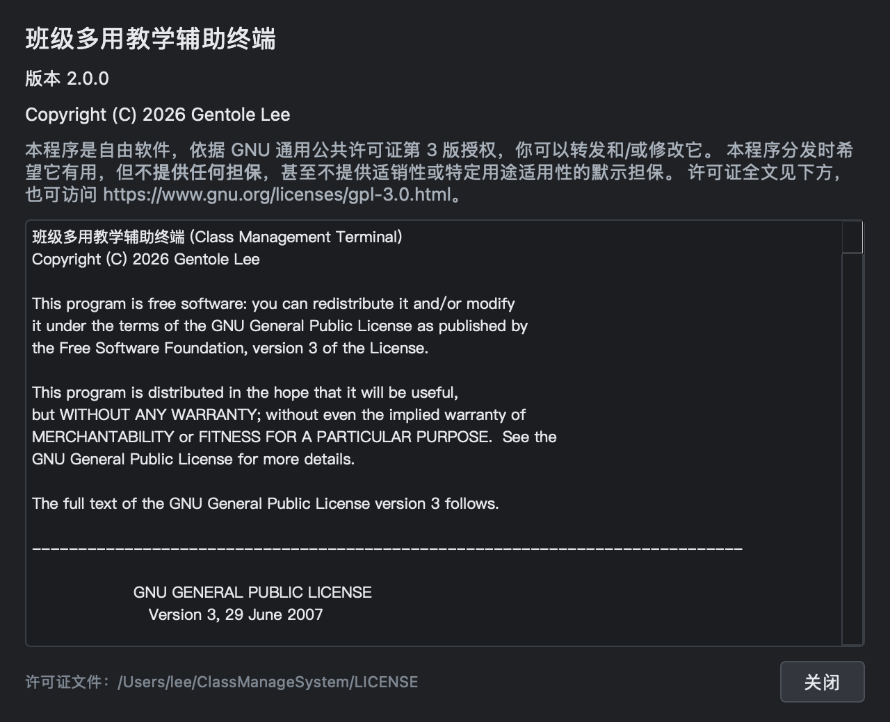
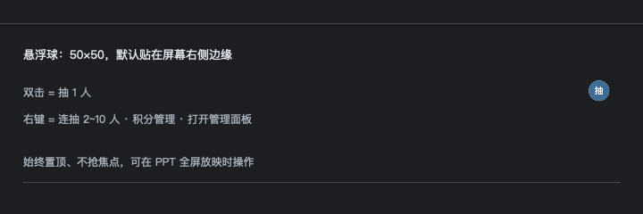

<h2 align="center">班级多用教学辅助终端</h2>

<p align="center">
  面向课堂教学的悬浮式随机点名 + 小组积分工具<br>
  <b>不遮挡课件、不抢焦点、不退出 PPT 全屏放映</b>，就能完成抽人、连抽和小组加减分。
</p>

<p align="center">
  <a href="#chinese"></a>
  &nbsp;
  <a href="#english"></a>
</p>

<p align="center">
  
  
  
  
  
</p>

<p align="center">
  
</p>

<p align="center">
  <sub>本页中英双语 · This page is bilingual — 点上方徽章或下方链接切换 / use the badges or links above to switch</sub>
</p>

---

<a id="chinese"></a>

# 中文

<p align="right"><a href="#english">English version ↓</a></p>

## 目录

- [截图](#截图)
- [它解决什么问题](#它解决什么问题)
- [功能特性](#功能特性)
- [快速开始](#快速开始)
- [使用说明](#使用说明)
- [界面语言（中文 / English）](#界面语言中文--english)
- [数据与安全](#数据与安全)
- [核心设计：为什么不用纯随机](#核心设计为什么不用纯随机)
- [跨平台支持](#跨平台支持)
- [打包](#打包)
- [项目结构](#项目结构)
- [测试](#测试)
- [开发注意事项](#开发注意事项)
- [常见问题](#常见问题)
- [已知限制](#已知限制)
- [许可证](#许可证)

---

## 截图

> 下面的图由 `python tools/make_screenshots.py` 直接抓取真实控件生成，界面改动后重跑一次即可同步，不是手绘示意图。

### 小组积分面板

单击卡片展开操作按钮，双击组名重命名，支持撤销与快捷键。底栏「操作日志」是日志的唯一入口。


### 操作日志

每次积分变动自动记录一条，加密存储、只增不减、可自动回档。只读，不可编辑。
每条记录同时保存中英两版：

| 中文 | English |
|---|---|
|  |  |

### 悬浮球


### 抽选结果弹窗

连抽只弹一个窗口，多个名字同时滚动、一起揭晓，`✕` 关闭或 5 秒后自动消失。


### 关于：版本与许可证

版本号、版权、不担保声明，以及可直接滚动的 Apache-2.0 许可证全文。



### 彻底重置：选择清空范围

组名 / 积分 / 长期公平记录 / 抽取历史可分别勾选，点「重置」后再二次确认。


### 管理面板

名单加载、冷却倒计时、抽取历史、开机自启动、托盘入口。


### 深色模式

界面跟随系统外观（**仅 macOS 已实测自动跟随**）。Windows 下 Qt 实际返回的调色板仍为浅色，
不会自动跟随系统深色（程序未做注册表 / `colorScheme` 主动检测）；可用下方环境变量强制开启。
无论哪一档，都不是把浅色主题硬套一遍：
卡片、按钮、表格、日志区都有各自的深色配色，文字与背景保持足够对比度。
也可用环境变量强制预览：`CLASSMANAGE_THEME=dark python main.py`。

| 积分面板 | 操作日志 |
|---|---|
|  |  |

| 抽签结果弹窗 | 悬浮球 |
|---|---|
|  |  |


---

## 它解决什么问题

在小组合作学习、课堂竞赛、随机点名、任务分配这类场景里，老师经常需要：

- 随机抽一个人回答问题；
- 一次抽 2~10 人做分组活动或任务分配；
- 给各学习小组加/减分，记录课堂表现；
- **在 PPT 全屏放映中完成以上操作，不退出课件、不切屏、不打断讲课**。

程序默认以一颗 50×50 的悬浮球停在屏幕右侧：双击抽人，右键连抽 / 开积分面板 / 开管理面板。所有关键窗口置顶但不抢焦点，弹窗自动关闭，关闭积分面板也不会退出程序 —— 老师可以一直留在 PPT 全屏里，像用遥控器一样完成课堂互动。

### 核心特点

| 特点 | 说明 |
|---|---|
| **不挡课件** | 悬浮球只有 50×50，默认贴屏幕右侧边缘，可拖到任意位置 |
| **无需退出课件** | 悬浮球强制置顶（Windows 用 `SetWindowPos(HWND_TOPMOST)`；macOS 设置 NSWindow 层级与 Space 行为），可覆盖在 PPT 之上 |
| **不抢焦点** | 悬浮球与弹窗使用 `Qt.WindowDoesNotAcceptFocus`，不打断键盘输入与 PPT 操作 |
| **公平抽选** | 不是 `random.choice`，而是「加权少抽优先 + 每人冷却」，长期看每人被抽次数更均衡 |
| **积分防篡改** | AES-256-GCM 加密 + 三级自动回档，学生改文件改不动分数 |
| **常驻托盘** | 关闭主窗口/积分面板都不退出，只有托盘菜单「退出」才结束进程 |

---

## 功能特性

### 课堂操作（不打断讲课）

- 双击悬浮球 → 抽 1 人；右键 → 连抽 2~10 人 / 积分管理 / 打开管理面板。
- 揭晓前有滚动动画（1.8 秒），结果弹窗居中、带 `✕`、5 秒后自动关闭。
- 连抽只弹一个窗口，多个名字同时滚动、一起揭晓。
- 悬浮球与弹窗都不抢焦点。

### 学习小组积分

- 默认 6 组，可调 1~24 组；每组一张卡片。
- 单击展开 `-1 / +1 / +2 / +3`；双击组名重命名；右键清零本组。
- 支持 `Ctrl+Z` 撤销；快捷键 `1/2/3/4` 对应 `-1/+1/+2/+3`。
- 分数以加密签名的事件链（`Data/ledger.esc`）为准，重启不丢；
  被改坏、被删掉或被换回旧文件都会自动检测并恢复。
- 每次积分变动自动写入加密操作日志，底栏「操作日志」按钮只读查看；
  日志每条同时保存中英两版，切换语言后历史记录依然可读。
- 「彻底重置」会先弹出**选择清空范围**的对话框：组名 / 积分 / 长期公平记录 /
  抽取历史可分别勾选，确认后再二次确认，避免误伤不需要清的数据。
- 改组数会整段重置组名与分数（换组数就是换了一套分组，旧分数没有可挂靠的组）。

### 公平抽选

- 「加权少抽优先」：历史累计被抽次数越少，权重越高。
- 最近被抽中的人临时降权，避免连庄。
- 长期次数存在 `stats.ini`，重启仍生效。
- 课前「清空历史」只清历史与冷却，保留长期次数；只有「彻底重置」才清零长期次数。

### 管理面板：名单与冷却

- 名单来源：`.txt` 文件（一行一个名字，支持 `#` 注释），或按数字范围生成（默认 1~99）。
- 名单列表显示冷却倒计时，冷却中的学生变灰。
- 抽取历史表、每人冷却时间（1~60 分钟，默认 10）。
- 开机自启动开关（Windows 写注册表 Run 项；macOS 写 LaunchAgent）。
- 托盘菜单：显示主窗口 / 积分管理 / 抽取名字 / 彻底重置 / 退出。

---

## 快速开始

### 环境要求

- Windows 10 及以上（主要目标平台）、macOS 11 及以上；Linux 未验证。
- Python 3.10+、PySide6、cryptography（仅源码运行需要）。
- **原生模块** `native/cmd_native`（Windows 为 `cmd_native.exe`）：源码运行时必须存在，
  否则程序降级为「只读 + 状态栏提示」，不会崩溃。构建方法见「开发注意事项」。

```bash
pip install -r requirements.txt
```

### 源码运行

```bash
python main.py
```

不想留控制台窗口：

```bash
pythonw main.py          # Windows：pythonw 不弹控制台
```

macOS 直接 `python main.py` 即可；想做成双击启动的程序见 [打包](#打包)。

首次启动会在程序目录旁生成加密配置；没有历史名单时会自动生成 1~99 的数字名单。

### 下载可运行版本

当前版本 **3.0**（`namepicker/about_dialog.py` 的 `VERSION = "3.0.0"`）。

在 **GitHub Releases** 下载（若尚未发布，见 [打包](#打包) 自行构建）。

---

## 使用说明

### 悬浮球：操作方式

| 操作 | 效果 |
|---|---|
| 左键双击 | 抽 1 个人 |
| 左键拖动 | 移动悬浮球 |
| 右键 | 菜单：连抽 2~10 人 / 积分管理 / 打开管理面板 / 抽取名字 / 彻底重置 / 退出 |
| 抽中时 | 短暂闪金色 |

### 积分面板

| 操作 | 效果 |
|---|---|
| 单击卡片 | 展开操作按钮 |
| 双击组名 | 重命名 |
| 右键卡片 | 清零本组积分 |
| `Ctrl+Z` | 撤销最近一次加减分 |
| `1 / 2 / 3 / 4` | `-1 / +1 / +2 / +3` |
| 「小组数量...」 | 改组数（需二次确认，会清空组名与分数） |
| 「全部清零」 | 所有小组归零（不可撤销） |
| 「操作日志」 | 打开只读日志查看器（唯一入口，中英双语逐条显示） |

小组名支持任意长度的名字（外国人名可能几十个字符）：卡片和抽选弹窗会按宽度
自动省略显示「…」，完整名字放在 tooltip 里，鼠标悬停可见；抽选弹窗还会先缩小
字号、再把窗口宽度限制在屏幕内，不会把名字顶出屏幕。


上图同时展示了英文模式下的默认组名：只改过名字的小组显示自定义名，
没改过的显示 `Group 4/5/6`。

### 管理面板：各项设置

- 「名单来源」：浏览 `.txt` 名单，或按数字范围生成；「重置为学号」恢复默认 1~99。
- 「每人冷却」：1~60 分钟。
- 「开机自启动」：写入当前用户的自启动项。
- 「隐藏悬浮球」：临时隐藏/显示悬浮球。
- 「清空历史」：清空抽取历史与冷却，**保留**长期公平计数。
- 「关于」：分四个分页 —— **许可证**（Apache-2.0 全文）、**原生模块**（`native/LICENSE` 专有许可）、
  **第三方组件**（`THIRD-PARTY-NOTICES.md` 全文）、**依赖**（PySide6 / Qt 6 / libsodium 等清单与
  Qt 可替换说明）。托盘菜单与悬浮球右键里也有入口。
  ~~版本号实际写在**三处**，升级时需同步修改（当前三处不一致）：
  `namepicker/about_dialog.py` 的 `VERSION`（关于窗口显示，现为 `3.0.0`）、
  `packaging/windows/version_info.txt` 的 `filevers`/`prodvers`（EXE 属性，现为 `1.0.0.0`）、
  `packaging/macos/ClassManageSystem.spec` 的 `CFBundleShortVersionString`（.app 版本，现为 `1.0.0`）。
  打包脚本读的是 `version_info.txt`，**不会**从 `about_dialog.py` 读取。~~
  （删除缘由：2.0.0 起版本号已收敛为**单一来源**，上面的“三处同步”描述不再成立。）
  现在只改 `namepicker/about_dialog.py` 的 `VERSION` 一处即可：
  - Windows 打包时 spec 会把 `version_info.txt` 模板里的版本号替换掉，生成
    `version_info.generated.txt` 再交给 PyInstaller（模板不再手改）；
  - macOS 打包时 spec 直接读取 `VERSION`，填进 `CFBundleShortVersionString` / `CFBundleVersion`。
- 托盘「彻底重置...」：组名、积分、长期公平记录、抽取历史全部回到出厂状态。
- 「关于」窗口是**非模态**的：打开许可证时仍可双击悬浮球抽人；抽选结果会盖在它上面。
  （GPL 只要求许可证可查看，不要求阻塞整个程序。）
- 重置会**校验写盘**：若磁盘写入失败（Windows 上文件被占用/只读时 `os.replace` 会失败），
  会弹出「重置没有完全生效」并给出系统原因，界面回退到磁盘上的真实数据，不再假装成功。

---

## 界面语言（中文 / English）

界面、对话框、托盘/悬浮球菜单、操作日志全部支持中英双语。

- **切换方式**：管理面板底栏的语言下拉框（`中文` / `English`）。切换后会询问
  **是否立即重启**；选「是」会自动退出并重新拉起一个新进程，选「否」则下次启动生效。
- **生效时机**：界面文字不做热替换（Qt 没有 `retranslateUi`），因此需要重启。
- **默认值**：首次运行跟随系统语言；之后以保存的选择为准。
- **临时覆盖**：`CLASSMANAGE_LANG=zh|en` 环境变量，优先级最高，不写回设置
  （截图与自动化测试用）。
- **操作日志**：每条记录同时保存中文和 English 两个版本，查看器里两行一起显示，
  所以切换语言不会让历史记录变成看不懂的语言。
- **默认组名跟随语言**：还叫默认名的小组会显示为当前语言的默认名
  （中文 `第一组…` ↔ 英文 `Group 1…`）；**老师自定义过的组名保持原样**，
  不会被切换语言改写。日志内容同样不会被改写。
- **语言存两份**：`config.dat` 的 `meta.language` 与 `QSettings` 各存一份。启动顺序为
  `CLASSMANAGE_LANG` 环境变量 > `config.dat` > `QSettings` > 系统语言。
  （缘由：Windows 上注册表可能被重定向或受权限限制，只靠 QSettings 会出现“切了没生效”。）
- **立即重启防竞态**：新进程带 `--restarted` 启动，单实例会最多等 6 秒让旧进程退出；
  `QProcess.startDetached` 失败时退回 `subprocess`（Windows 带 `DETACHED_PROCESS`）。
- **启动诊断**：配置同目录的 `startup.log` 记录每次启动的版本、是否 frozen/restarted、
  三个来源读到的语言、最终语言、单实例结果与重启结果（最近 40 行，失败静默）。

| 中文界面 | English UI |
|---|---|
|  |  |


底栏右侧的下拉框就是语言开关：


`tools/` 下的脚本统一输出英文，便于把日志贴到 issue 里。

---

## 数据与安全

数据分两套机制，**分数的权威来源是事件链，配置文件只是缓存**。

### 一、事件链（分数）

每次改分、改组名、改组数，都会先经原生模块 `cmd_native`：

```text
界面操作
  → C++ 校验规则（组号 1..24、分数 ±100 万、组名长度）
  → 加密（XChaCha20-Poly1305）+ 计算链头（BLAKE2b-256）+ 签名（Ed25519）
  → 追加到 Data/ledger.esc
```

启动时整链验签并重放，用结果覆盖 `config.dat` 里的分数缓存。

| 文件 / 位置 | 角色 |
|---|---|
| `Data/ledger.esc` | 事件链，base64 行，只追加不覆盖 |
| `Data/anchor.json` | 基准：链曾经到过第几条、链头是什么 |
| `~/.cache/classmanage/<哈希>/anchor.json` | 同一基准的隐藏副本 |
| `~/.cache/classmanage/<哈希>/ledger.esc` | 安全副本，用于自动恢复 |
| `native/cmd_native`（Windows 为 `.exe`） | 原生模块：密钥、规则、加解密、签名 |

**能挡住什么**（均为实测）：

| 攻击 | 结果 |
|---|---|
| 改任意一条记录 | 验签失败，拒绝加载 |
| 删掉中间几条 | 序号断裂，拒绝加载 |
| 用旧文件覆盖 `Data/` | 链比基准短 → 从安全副本自动恢复 |
| 删空 `Data/` | 判定被删 → 从安全副本自动恢复 |
| 连 `config.dat` 一起换 | 仍然被基准发现（基准不在 `Data/` 里） |
| 把数据拷到别的电脑 | 机器指纹不同，验签失败 |
| 读源码找改分接口 | 规则在 C++ 里，接口只接受“加几分” |

**挡不住什么**（边界）：

- 连 `~/.cache` 一起还原的**完整快照**（需要知道三处位置，属于蓄意伪造）；
- 在老师电脑上**循环调用合法接口**加很多分（会留下 N 条带时间戳的签名事件，
  一眼可辨，且删不掉）。

### 二、配置文件（组名 / 组数 / 语言）

组名、组数、界面语言等仍按四级容灾逐级回退：

| 文件 / 位置 | 角色 | 程序行为 |
|---|---|---|
| `config.dat` | 加密主文件（AES-256-GCM） | 读 + 写 |
| `config.dat.bak` | 同目录加密备份 | 读（回档）+ 写 |
| `QSettings` 隐蔽备份 | Windows 注册表 / macOS plist / Linux conf | 读（回档）+ 写 |
| `config.ini` | 明文查看副本 | **只写，永不读** |

```text
config.dat → config.dat.bak → QSettings 隐蔽备份 → 旧版明文（一次性迁移）→ 默认值
```

任何一级读成功，都会把前面的副本重新写一遍（自动修复）。

### `config.dat` / `config.dat.bak`

- 内容为 `nonce(12B) + 密文 + GCM tag(16B)`，用记事本打开是乱码；
- **其中 `score_*` 只是缓存**：启动时会被事件链重放结果覆盖，单独改它无效；
- GCM 是认证加密：改任何一个字节，解密必然失败，程序随即回档到下一级副本。

### 密钥

**两套独立的密钥：**

| 用途 | 位置 / 来源 | 谁能看到 |
|---|---|---|
| 配置文件 `config.dat` | `~/.classmanage_key`（32 字节，权限 `600`） | Python 侧 |
| 事件链 `Data/ledger.esc` | 机器指纹派生，只存在于 C++ 进程内存 | Python 拿不到 |

事件链的密钥 = `BLAKE2b(机器 UUID ‖ 用户目录 ‖ 编译期盐)`，再由它派生加密钥与签名种子；
进程退出即清零。把数据拷到别的电脑（或换用户），派生出的密钥不同，验签必然失败。

配置文件密钥的行为：

- 首次运行自动生成 32 字节密钥到 `~/.classmanage_key`（macOS/Linux 权限 `600`）；
- 不硬编码在源码里，随用户账户隔离；
- 密钥文件写不进去时程序不会崩，会降级为「本次运行临时密钥」并把原因记在
  `crypto_utils.key_error()` 里（可用 `tools/config_crypto_check.py` 排查）。

### `config.ini`（查看副本）

每次保存重新生成，首行是 `# 仅供查看，修改无效`。**程序从不读取它**，手工改它不会影响分数，想改请用界面。

### `QSettings` 隐蔽备份

同一份密文再存一份到系统级位置，学生不易找到、也不好删：

```text
Windows : HKCU\Software\YourOrg\ClassManageSystem
macOS   : ~/Library/Preferences/com.YourOrg.ClassManageSystem.plist
Linux   : ~/.config/YourOrg/ClassManageSystem.conf
```

用 `QSettings` 而非 `winreg`，一套代码三平台通用，macOS 下不会 `ModuleNotFoundError`。写入失败静默忽略，绝不影响主流程。

### `points_log.dat`（操作日志）

- 自动记录：加/减分、撤销、清零本组、全部清零、改组数、彻底重置；
- 分数没变化时不记录；组名重命名不记录（不是积分变动）；
- **只增不减**：最多保留最近 400 条（`seq` 是历史累计条数并持续增长），因此
  「哪份副本的 `seq` 最大就用哪份」—— 拿旧密文覆盖主文件这种**回滚式篡改**也会被自动修回；
- 「彻底重置」不清空日志，只追加一条标记：审计记录不能靠一个按钮抹掉；
- 磁盘上**没有明文副本**，唯一查看入口是积分面板的「操作日志」按钮；
- 每条记录存 `(时间, 中文, English)` 三元组，旧版纯文本记录也能继续读取
  （英文侧留空，只显示原文）。

### `stats.ini`

长期抽取次数，与配置同目录，明文存储（不含积分）。

```ini
[counts]
张三 = 5
李四 = 3
```

独立成文件的原因：若与积分放在一起，课前「清空历史」会连带清掉长期次数，加权就退化成"每节课各自独立随机"。

### `crash.log`

与配置同目录，记录 Python traceback 与原生崩溃，最多 200 条。**0 字节表示没有崩溃**。

### `startup.log`

与配置同目录，**只为诊断启动/重启问题**：每次启动追加几行（版本、是否 frozen、
是否由「立即重启」拉起、环境变量/`config.dat`/`QSettings` 三种来源读到的语言、
最终生效语言、单实例是否抢到、重启是否成功），只保留最近 40 行。
不参与任何业务判断，写入失败一律静默；`.gitignore` 已忽略该文件。

### 数据放在哪

配置与日志写在**程序所在目录**旁（打包后是 EXE / `.app` 同级目录，不在 `.app` 包内部）；若该目录不可写，则整体回退到：

```text
Windows        : %APPDATA%\ClassTerminal2411\
macOS / Linux  : ~/ClassTerminal2411/
```

---

## 核心设计：为什么不用纯随机

`random.choice` 对「每一次」抽取是均匀的，但对「每个学生一学期」不是。40 人里出现有人被抽两次、有人一次没抽到是很常见的聚集现象，学生看到的就是「老师老抽他」。

因此 `NameEngine` 使用加权少抽优先模型：

```text
weight = (max_count - count + 1) ** FAIRNESS_STRENGTH
         * recency_penalty
```

参数位于 `namepicker/name_engine.py` 顶部：

| 参数 | 默认值 | 说明 |
|---|---:|---|
| `FAIRNESS_STRENGTH` | `4.0` | 向最少被抽者倾斜的强度。调到 9 会接近固定轮换。 |
| `RECENT_GAP` | `4` | 最近 N 次内被抽中过则降低权重。 |
| `RECENT_PENALTY` | `0.35` | 刚被抽中者的权重下限，避免连庄。 |
| `MIN_WEIGHT` | `0.01` | 保证每个有资格的人仍有可能被抽中。 |

两个语义不同的重置：

- `clear_history()`：清空抽取历史与冷却，**保留**长期累计次数 —— 对应教师课前的「清空历史」。
- `reset_fairness()`：连同长期累计次数一起清零 —— 用于新学期、换班级或「彻底重置」。

修改公平性参数后建议重跑基准：

```bash
python tools/fairness_benchmark.py
python tools/fairness_burnin.py
```

---

## 跨平台支持

| 能力 | Windows | macOS | Linux |
|---|---|---|---|
| 抽选 / 积分 / 日志 | ✅ | ✅ | 未验证 |
| 盖住全屏应用 | ✅ `SetWindowPos` | ✅ accessory 策略 + 浮层属性（已实测） | 未验证 |
| 对话框显示在全屏应用之上 | ✅ `SetWindowPos(HWND_TOPMOST)`（2.0.0 起） | ✅ 对话框抬到 level 26（已实测） | 未验证 |
| 对话框定位（主窗口隐藏时） | ✅ 按鼠标所在屏幕居中 | ✅ 按鼠标所在屏幕居中 | 未验证 |
| 托盘 / 菜单栏图标 | ✅ 彩色托盘图标 | ✅ 模板图；**菜单栏自动隐藏时不显示** | 未验证 |
| 浅色 / 深色模式 | ❌ 不自动跟随（可环境变量强制） | ✅ 跟随系统 | 未验证 |
| 系统级隐蔽备份 | ✅ HKCU 注册表 | ✅ `~/Library/Preferences` plist | ✅ `~/.config` |
| 悬浮球置顶 | ✅ `SetWindowPos(HWND_TOPMOST)` | ✅ 层级 + `CanJoinAllSpaces`/`FullScreenAuxiliary`/`Stationary` | 未验证 |
| Dock 图标 | — | ❌ 无（accessory 策略的代价，见下） | — |
| 开机自启动 | ✅ 注册表 Run 项 | ✅ LaunchAgent | ❌（返回失败） |
| 冻结后数据位置 | ✅ EXE 同级目录 | ✅ `.app` **同级**目录（不在包内） | — |

设计约定：**不直接 `import winreg`**（改为 `try/except ImportError`），平台专有调用全部包在 `try/except` 里并静默降级；存储层统一走 PySide6 自带的 `QSettings`；配色与字体统一由 `namepicker/theme.py` 提供。

---

## 打包

> **PyInstaller 不支持交叉编译**：在 macOS 上只能打出 macOS 程序，`.exe` 必须在 Windows 上打包
> （本机或 Windows runner）。测试已支持无头运行（`QT_QPA_PLATFORM=offscreen`），
> 不再依赖真实显示器。

### Windows —— 唯一可行方式：本机打包

> 说明：CI 出包流程目前**未启用**（`.github/workflows` 保留但不再自动触发）。
> 打包本身仍是 PyInstaller 的一步，在任意一台 Windows 上执行即可；
> 测试已可在无头环境运行，不再需要真实显示器。

请在任意一台 Windows 上打包：

```bat
packaging\windows\build.bat
```

脚本会自动建 `.venv-build` 虚拟环境、装依赖、跑自检、打包，产物是目录 `dist\ClassManageSystem\`（含 `ClassManageSystem.exe` 与 `_internal\`），再由安装程序打成安装包。

**pip 源自动选择**（不用手动判断自己在国内还是国外）：

| 用法 | 行为 |
|---|---|
| `build.bat` | **自动测速**：探测全部候选源，选响应最快的那个 |
| `build.bat official` | 强制官方 PyPI，跳过探测 |
| `build.bat <镜像URL>` | 强制指定源，可信主机自动从 URL 解析 |

测速原理：用 `curl.exe` 向每个候选源发一个 1 KB 的 ranged 请求，读取 `%{http_code}` 与 `%{time_total}`，把秒换算成整数毫秒后取最小值（`000` 视为不可达）。批处理没有浮点运算，换算靠字符串补位完成——`0.042` → 整数部分 `0` + 小数前三位 `042` → **42 ms**；`1!F3!-1000` 这个写法是为了避免 `042` 被当成八进制读成 34。

没有 `curl`（Windows 10 17063 以下没有自带）时跳过测速，退回内置顺序 **清华 → 阿里 → 官方 pypi.org**。

装依赖时如果当前源失败，脚本会**自动换下一个候选源重试**，而不是卡在第一次超时上退出——PySide6 基础包约 100 MB，这条比测速更保命。

镜像只作用于这条命令，**不写 `pip.ini`、不改系统全局 pip 配置**。

### macOS

```bash
packaging/macos/build.command        # 双击也可以
```

产物 `dist/ClassManageSystem.app`。打出来是**当前 CPU 架构**的原生程序（Apple Silicon 上是 arm64；要通用需 universal2 的 Python + PySide6）。

### 安装包形态

| 平台 | 产物 | 说明 |
|---|---|---|
| Windows | `ClassManageSystem-<版本>-Setup.exe` | Inno Setup 安装程序：**按用户安装**（`%LOCALAPPDATA%\Programs`），**不需要管理员权限**；带许可证页、开始菜单与桌面快捷方式、卸载器 |
| Windows | `ClassManageSystem-<版本>-portable.zip` | 便携版，解压即用 |
| macOS | `ClassManageSystem-<版本>.dmg` | 拖入「应用程序」即可；受限环境无法建 DMG 时退回落成 zip |

Windows 的安装包由 CI 生成（见 `.github/workflows/build-windows.yml`）：
测试 → PyInstaller 目录包 → Inno Setup → 上传安装包与便携版。

### 产物说明

- 目录形态（`dist/ClassManageSystem/`）＋安装程序，目标机不需要装 Python；
- **原生模块随包分发**：`_internal/native/cmd_native.exe`（macOS 为
  `Contents/Frameworks/native/cmd_native`）。缺了它程序只能以只读模式运行，
  因此打包配置会在缺失时**直接让构建失败**；
- **Qt 库是独立文件**（`_internal/` 下的 `Qt*.dll` / `.framework`），安装后可被替换，
  满足 LGPL v3 对「用户能替换库」的要求；单文件 EXE 做不到这一点，因此不再使用；
- 配置与日志写在 EXE / `.app` 同级目录（只读目录则回退 `%APPDATA%\ClassTerminal2411`），密钥在用户主目录；
- **未做代码签名**：Windows 首次运行 SmartScreen 会提示「未知发布者」，点「更多信息 → 仍要运行」；macOS 拷给别人后首次需**右键 → 打开**。

---

## 项目结构

```text
.
├── main.py                          # 入口：组装组件、连接信号、进入事件循环
├── requirements.txt
├── names.txt                        # 示例名单
├── LICENSE                          # Apache License 2.0 全文
├── NOTICE                           # 版权与归属声明（Apache-2.0 要求）
├── THIRD-PARTY-NOTICES.md           # PySide6 / Qt / libsodium 等第三方声明
├── native/                          # 原生模块（只发布二进制；源码不进仓库）
│   ├── LICENSE                      # 专有许可：随程序使用，禁止单独分发/逆向
│   ├── CMakeLists.txt               # 构建定义（源码在 native/src/，已 gitignore）
│   ├── build_macos.sh               # clang + 静态 libsodium，strip + ad-hoc 签名
│   ├── build_windows.sh             # zig 交叉编译（无需 MSVC / 管理员）
│   ├── cmd_native.exe               # Windows 构建产物
│   └── cmd_native                   # macOS 构建产物
├── docs/images/                     # README 截图（由 tools/make_screenshots.py 生成）
│
├── namepicker/                      # 主程序包
│   ├── _init_.md                    # 包内文件职责说明
│   ├── config_store.py              # 配置持久化（四级容灾）+ 分数缓存
│   ├── crypto_utils.py              # AES-256-GCM 与 ~/.classmanage_key 密钥管理
│   ├── log_store.py                 # points_log.dat：加密操作日志 + 防回滚
│   ├── backup_store.py              # QSettings 系统级隐蔽备份（跨平台）
│   ├── stats_store.py               # stats.ini：长期抽取次数
│   ├── name_engine.py               # 抽取逻辑：公平加权、冷却、历史
│   ├── floating_ball.py             # 悬浮球（含跨平台强制置顶）
│   ├── draw_popup.py                # 结果弹窗与滚动动画
│   ├── points_window.py             # 积分面板 + 操作日志查看器
│   ├── main_window.py               # 管理面板、托盘、开机自启动、语言切换
│   ├── i18n.py                      # 中英双语：tr() / both() / Qt 翻译装载
│   ├── atomic.py                    # 原子替换 + Windows 占用重试
│   ├── dialogs.py                   # 对话框定位：隐藏父窗口、屏幕居中、延后打开
│   ├── win_window.py                # Windows：对话框置顶（SetWindowPos）
│   ├── startup_log.py               # 启动/重启诊断日志（startup.log）
│   ├── about_dialog.py              # 关于窗口：版权 / 不担保声明 / GPL 全文
│   ├── widgets.py                   # ElidedLabel：长名字按宽度省略 + tooltip 全名
│   ├── restart.py                   # 切换语言后的「立即重启」（源码/打包两种参数）
│   ├── wipe_dialog.py               # 彻底重置：勾选清空范围 + 二次确认
│   ├── wipe_service.py              # 按勾选项逐项清空（可单测）
│   ├── theme.py                     # 浅/深色配色 token、跨平台字体、托盘图标
│   ├── macos_window.py              # macOS 激活策略 + 全屏浮层
│   ├── single_instance.py           # 单实例守护（QLocalServer 判活）
│   └── crash_log.py                 # 崩溃日志
│
├── packaging/
│   ├── windows/                     # PyInstaller spec、图标、版本信息、build.bat
│   ├── macos/                       # PyInstaller spec、icns、build.command
│   └── make_icon.py                 # 生成 Windows 图标（Qt 渲染，无需 Pillow）
│
├── tools/                           # 测试与开发脚本（不随程序分发）
│   ├── config_check.py              # 存储往返测试（不依赖 Qt）
│   ├── config_crypto_check.py       # 加密存储 / 篡改回档 / 迁移 自检
│   ├── log_crypto_check.py          # 操作日志：自动记录 / 篡改回档 / 防回滚
│   ├── windows_check.py             # Windows 平台自检（注册表 / 置顶 / 编码 / 占用）
│   ├── macos_check.py               # macOS 平台自检（菜单栏 / 浮层 / 深色 / 全屏覆盖）
│   ├── _fullscreen_helper.py         # 自检用：进入原生全屏的辅助进程
│   ├── smoke_test.py                # GUI 冒烟测试
│   ├── group_count_stress.py        # 小组数量功能 + 300 轮压力
│   ├── make_screenshots.py          # 生成 docs/images 下的 README 截图（中/英、深/浅）
│   ├── wipe_check.py                # 彻底重置的勾选与逐项清空测试
│   ├── i18n_check.py                # 双语切换 / 持久化 / 双语日志测试
│   ├── fairness_burnin.py           # 1 万次单抽烧机 + χ² 检验
│   ├── fairness_benchmark.py        # 公平性调参基准
│   ├── reset_fairness_benchmark.py  # 教师清空历史工作流模拟
│   ├── weighting_demo.py            # 新旧算法分布对比
│   ├── repro_quit.py                # 「关闭面板导致退出」最小复现
│   ├── _settings_isolation.py       # 测试用的 QSettings 命名空间隔离
│   ├── _headless.py                 # 无头模式：屏蔽所有模态框，CI 不阻塞
│   ├── run_all_tests.py             # 一键跑全套测试（自动找解释器 / 限时 / 隔离）
│   ├── run_all_tests.command        # macOS 双击启动器
│   └── run_all_tests.bat            # Windows 双击启动器
│
└── .github/workflows/build-windows.yml   # CI 构建流程（当前未启用，见「打包」）
```

---

## 测试

**最省事的方式**：双击 `tools/run_all_tests.command`（macOS）或
`tools/run_all_tests.bat`（Windows），或运行：

```bash
python tools/run_all_tests.py            # 全套，offscreen（等价 CI）
python tools/run_all_tests.py --gui      # 真实窗口，本机调试
python tools/run_all_tests.py -k wipe    # 只跑名字含 wipe 的
python tools/run_all_tests.py -q         # 只看失败摘要（默认打印全量输出）
```

它会自动选解释器（`.conda` → `.venv-build` → 当前 Python），给需要写数据的测试
分配临时 `HOME`，并逐项限时（单项卡住不会拖垮整场）。

单独运行某一项：

```bash
python tools/config_check.py           # 最快，不依赖 Qt：存储读写/合并/清零/重置
python tools/config_crypto_check.py    # 加密存储：乱码、手改无效、篡改/删除回档、迁移
python tools/log_crypto_check.py       # 操作日志：自动记录、无明文副本、防回滚、只增不减
python tools/windows_check.py          # 平台自检（在 Windows 上才跑真实分支）
python tools/macos_check.py            # 平台自检（菜单栏 / 浮层 / 深色 / 激活策略 / 模态框层级）
python tools/macos_check.py --fullscreen   # 额外跑一次「真·原生全屏」覆盖测试
python tools/smoke_test.py             # GUI 冒烟：信号连接、布局、落盘、撤销、连抽
python tools/group_count_stress.py     # 小组数量功能 + 300 轮压力
python tools/wipe_check.py             # 彻底重置：勾选项与逐项清空行为
python tools/i18n_check.py             # 双语：默认组名、重启参数、长名字省略、双语日志(需要GUI)
python tools/native_check.py           # 原生模块：状态机、规则拒绝、篡改/重排/换机器
python tools/ledger_check.py           # 事件链：迁移、C++ 改分、回档检测、安全副本恢复
```

- `wipe_check` 现在覆盖：写盘失败必须被报告（只读目录）、失败后界面回退到磁盘真实数据、
  `os.replace` 遇到 Windows 占用时的重试与最终失败。
- `i18n_check` 现在覆盖：关于窗口非模态时悬浮球仍可抽人、隐藏父窗口下的对话框定位、
  语言双写、`--restarted` 参数、单实例重试（跨进程）。
- `windows_check` 现在覆盖：对话框置顶（`WS_EX_TOPMOST`）、语言写入 `config.dat`。
- `config_crypto_check` / `log_crypto_check` 会在临时 HOME 下运行，**不碰你的真实数据**；装了 PySide6 时还会验证真实的 QSettings 隐蔽备份。
- 冒烟测试构造 `MainWindow` 会读写真实注册表（Windows），脚本会先备份开机自启动项、跑完还原；macOS/Linux 自动跳过。
- 测试统一使用隔离的 QSettings 命名空间，不会污染真实注册表 / plist。

公平性专项：

```bash
python tools/fairness_burnin.py        # 冷启动长跑、偏斜追赶、χ² 检验、连庄率…
python tools/fairness_benchmark.py     # 对比 FAIRNESS_STRENGTH = 2/4/6/9 与纯随机
python tools/reset_fairness_benchmark.py   # 模拟每节课前「清空历史」的工作流
python tools/weighting_demo.py         # 新旧算法分布对比
```

重新生成 README 截图：

```bash
python tools/make_screenshots.py                          # 浅色（默认）
CLASSMANAGE_THEME=dark python tools/make_screenshots.py   # 深色，输出 *-dark.png
```

截图脚本会把窗口移到屏幕外再 `grab()`，不会在你桌面上闪；数据用临时目录，
不碰真实配置。

---

## 开发注意事项

- 改 `name_engine.py` 顶部公平性参数后，请重跑公平性基准与烧机测试。
- `clear_history()` 与 `reset_fairness()` 语义不同，改之前务必确认。
- `points_window.py` 中旧卡片销毁前必须先 `hide()`，否则会闪成独立顶层窗口。
- 积分卡片样式按 `(选中态, 颜色)` 缓存，避免连续点击时高频重刷。
- 徽标定时器只创建一次并复用，不要在每次点击时重建 `QTimer`。
- 正式运行没有控制台时，排错先看 `crash.log`。
- 单实例守护**不能只看 `QSharedMemory`**：Unix 上共享内存段不随进程消失而释放，
  被 `kill -9` 后残留的孤儿段会让下次启动永远静默退出。现在以 `QLocalServer`
  能否连通作为存活判据，共享内存仅作兜底。
- 对话框抬升器分平台：macOS `macos_window.install_dialog_raiser()`（level 26）、
  Windows `win_window.install_dialog_raiser()`（`SetWindowPos(HWND_TOPMOST)`）。
  **只在 Show 时抬，不要在 WindowActivate 时再抬** —— 对话框弹出自己的二次确认框会触发
  WindowActivate，再 `raise_()` 会把父框盖到确认框上，表现成“点了没反应”。
- 从 `QMenu` 动作里开对话框要用 `dialogs.defer()` 延后一拍；Windows 上同步打开不会被激活。
- 对话框的父窗口不可见/最小化时传 `None`，并用 `dialogs.center_on_screen()` 定位。
- 所有磁盘写入走 `atomic.replace_with_retry()`：Windows 上目标被占用时 `os.replace` 会失败，
  重试 3 次（0.12s / 0.24s 退避）能吃掉杀软与索引服务的瞬时锁。
- 「彻底重置」必须检查 `store.save()` 的返回值并读回校验；失败时先 `reload_from_disk()`
  让界面回到磁盘真实数据，再弹错误 —— **不要只刷内存**，否则界面和磁盘会长期不一致。
- Qt 绑定是 **PySide6（Qt 6）**，不是 PyQt5。迁移时的坑：
  * `QAction` 从 `QtWidgets` 移到了 **`QtGui`**；
  * `pyqtSignal`/`pyqtSlot` → `Signal`/`Slot`，`exec_()` → `exec()`；
  * `sip.isdeleted(x)` → `shiboken6.isValid(x)`；
  * `PYQT_VERSION_STR` / `QT_VERSION_STR` 不存在，用 `qVersion()`；
  * Qt6 里 `windowModality()` 返回**枚举**（`Qt.WindowModality.NonModal`），
    不要和整数 `0` 比较。
- **offscreen 下不能碰 macOS 原生窗口**：`QT_QPA_PLATFORM=offscreen` 时 `winId()`
  不是真实 NSView，对它发 objc 消息会**段错误**（实测 exit=-11）。
  `macos_window` 里所有入口都以 `QGuiApplication.platformName()` 是否 `cocoa` 为前置条件。
- **测试里不能出现阻塞式对话框**：CI/无头环境没人点「确定」，会永久卡住。
  `tools/_headless.py` 的 `install()` 会把 `QMessageBox` 的四个静态方法替换成
  立即返回；新增测试请在创建 `QApplication` 前调用它。
- **业务规则只在 C++ 里**：不要在图界面或 `ConfigStore` 里再判断“组号是否合法 /
  分数是否超限”。新增操作走 `ConfigStore._ledger_apply(op, **kwargs)`，
  由 `cmd_native apply` 校验；被拒绝时返回 `False`，调用方必须放弃本次改动。
- **改完 C++ 一定要重编两个平台**：`native/build_macos.sh` 与
  `native/build_windows.sh`（zig 交叉编译，无需 MSVC / 管理员）。
  libsodium 源码放在 `native/third_party/`（已 gitignore）。
- **事件格式由 C++ 定义**：Python 只把 `record` 当不透明字节追加到
  `Data/ledger.esc`，不要解析；需要状态就调 `cmd_native state`。
- **数值上限要对齐**：C++ 的 `MIN_GROUPS/MAX_GROUPS` 与 `config_store` 的
  `MIN_GROUP_COUNT/MAX_GROUP_COUNT` 必须一致。
- 打包相关：`config_store._app_dir()` 对 `.app` 有专门处理，避免把数据写进应用包内部；
  Windows 的 `.bat` 必须是**纯 ASCII + CRLF**（`.gitattributes` 已强制 `eol=crlf`），
  且 `REM` 行里不能出现未配对的圆括号 —— cmd 的括号配对统计会因此从行中间截断命令。
- **浮层会盖住对话框（踩过的坑）**：积分面板/结果弹窗为了盖住全屏 PPT 被设成
  `NSStatusWindowLevel(25)`，而模态对话框（改名、确认框）默认是
  `NSModalPanelWindowLevel(8)` —— 对话框被面板盖住、模态循环还在等点击，
  表现就是「点改名后整个程序假死」。修复见 `macos_window.install_dialog_raiser()`：
  应用级事件过滤器把所有 `QDialog` 抬到 level 26 并置前（`tools/macos_check.py`
  有回归测试，会对比两者的 level 与前后顺序）。

---

## 常见问题

### 双击图标没反应，进程一闪就退？

旧版本的单实例实现会在共享内存残留后永久拒绝启动（见「开发注意事项」）。当前版本已改为
`QLocalServer` 判活，被强杀后能正常重启。若仍复现，先确认没有另一个实例在跑：

```bash
pgrep -fl ClassManageSystem        # macOS
tasklist | findstr ClassManage     # Windows
```

### 关闭积分面板后程序消失了？

已修复，`main.py` 中设置了 `app.setQuitOnLastWindowClosed(False)`。复现脚本：`python tools/repro_quit.py`。

### 分数没有保存？

检查程序所在目录（放 `config.dat` 的那个目录）是否可写；只读时会自动回退到
`%APPDATA%\ClassTerminal2411\`（macOS/Linux：`~/ClassTerminal2411/`）。
`python tools/config_crypto_check.py` 可以定位是密钥、密文还是目录权限的问题。

### 学生改了 `config.ini` 的分数，为什么没生效？

因为程序从不读取 `config.ini`，它每次保存都会被加密数据覆盖。真正生效的是 `config.dat`
（外加 `.bak` 与系统级隐蔽备份）。改 `config.dat` 也一样：GCM 认证加密会让解密失败，
程序自动从备份回档。想删数据也不行 —— 删掉主文件会从 `.bak` 恢复，两个都删会从
QSettings 隐蔽备份恢复。

### 操作日志能删吗？

不能，这是设计。日志只增不减，「彻底重置」也只追加一条标记。想留档可以截图或复制
查看器里的文本。

### 「清空历史」后公平性会失效吗？

不会。它只清历史与冷却，长期次数保留在 `stats.ini`；只有「彻底重置」才清零长期次数。

### 为什么连抽人数不足？

因为部分学生仍在冷却中。连抽只从当前可用名单里抽，返回实际抽到的人数并给出提示。

### 程序无提示退出怎么办？

看 `crash.log`。0 字节通常说明不是崩溃（可能被强杀或正常退出）。

### 彻底重置后数据没变，或提示「重置没有完全生效」？

2.0.0 起重置会**校验写盘**。看到这个提示说明 `store.save()` 失败：弹窗里的「原因」就是系统错误
（例如 `Permission denied: ...config.dat.tmp`），同时 `startup.log` 里有一条
`wipe ... saved=False`。常见原因：Windows 上 `config.dat` 带只读属性（多由 zip 解压保留）、
被杀软/OneDrive 短暂占用、程序目录不可写。取消只读或关掉占用程序后重试即可。

（旧版本这里不检查保存结果，界面显示“已重置”但磁盘没变 —— 这是已修复的 BUG。）

### Windows 下「关于」「彻底重置」窗口不显示？

已修（2.0.0）：Windows 新增对话框置顶器，`QDialog` 显示时设为 `HWND_TOPMOST` 并置前；
主窗口隐藏到托盘时不再拿它的几何定位（Windows 上最小化窗口在屏幕外），改为按鼠标所在屏幕居中；
从托盘/悬浮球菜单打开时延后一拍，等菜单事件循环退出再显示。

### 打开「关于」后不能双击悬浮球抽人？

已修（2.0.0）：关于窗口改为**非模态**；它停在 level 25（与积分面板同级），
抽选结果会盖在它上面。

### 打包时报 `'xxx' 不是内部或外部命令`？

`.bat` 被存成了 UTF-8/LF 或 `REM` 行里有未配对括号。本仓库的 `build.bat` 已按
纯 ASCII + CRLF 修正；自行改动时请保持同样的编码与换行，否则 cmd 解析会出错。

---


## 已知限制

- **未做代码签名/公证**：Windows 有 SmartScreen 提示，macOS 拷贝到别的机器需右键打开。
- **不能交叉编译**：受限于 PyInstaller，macOS 上打不出 `.exe`，Windows 包必须在 Windows 上构建。
  （测试本身已可在无头环境运行：`tools/run_all_tests.py` 默认 offscreen。）
- **macOS 全屏覆盖靠「应用激活策略」**：窗口层级再高也没用 —— regular 应用自己占着
  一个桌面 Space，别的 App 进全屏后它压根不在那个 Space 里。本程序启动时会切到
  **accessory** 策略（`LSUIElement`，与 Alfred / Raycast 相同），窗口才能加入
  全屏 Space。代价是**没有 Dock 图标**；入口改为悬浮球 + 菜单栏图标。
  已用 `CGWindowList onScreenOnly` 对真实原生全屏做过实测：
  `python tools/macos_check.py --fullscreen` 会显示「悬浮球可以盖在原生全屏应用之上 ✅」。
- **macOS 菜单栏图标**：图标本身是模板图、状态项也确实创建了（自检会验证
  `NSStatusBarWindow`）。如果系统开启了「自动隐藏菜单栏」（`_HIHideMenuBar=1`），
  菜单栏收起时状态项按系统设计就不显示 —— 这不是程序问题。此时可用悬浮球右键菜单，
  里面已包含托盘的全部动作（抽取名字 / 积分管理 / 打开面板 / 彻底重置 / 退出）。
  想要常驻可见，请在 系统设置 → 外观（或桌面与程序坞）关闭「自动隐藏菜单栏」。
- **事件链也受同账户限制**：事件链的密钥由机器指纹派生、只存在于 C++ 进程内存，
  不落盘；但若教师与学生共用同一个系统登录账户，能在这台机器上运行程序并调试的人，
  理论上仍可提取运行中的密钥。这是「单机 + 同账户」的前提决定的上限，不是实现缺陷。
- **完整快照还原不在防护范围**：同时替换 `Data/`、`config.dat` 与 `~/.cache/classmanage/`
  的整机快照可以骗过校验（需要知道三处位置，属于蓄意伪造）。
- **Linux 未验证**：代码有平台守卫不会崩，但托盘/置顶行为未测试。

---

## 许可证

本项目以 **Apache License 2.0** 发布。

```text
Copyright 2026 Gentole Lee

Licensed under the Apache License, Version 2.0 (the "License");
you may not use this file except in compliance with the License.
You may obtain a copy of the License at

    http://www.apache.org/licenses/LICENSE-2.0

Unless required by applicable law or agreed to in writing, software
distributed under the License is distributed on an "AS IS" BASIS,
WITHOUT WARRANTIES OR CONDITIONS OF ANY KIND, either express or implied.
See the License for the specific language governing permissions and
limitations under the License.
```

- 完整条款：[`LICENSE`](LICENSE)（Apache-2.0 官方全文 + 本项目版权声明）
- 版权与归属：[`NOTICE`](NOTICE)
- 第三方组件声明：[`THIRD-PARTY-NOTICES.md`](THIRD-PARTY-NOTICES.md)
- 在线版本：<https://www.apache.org/licenses/LICENSE-2.0>

**作为使用者你需要知道：**

- 可以自由使用、修改、再分发，**包括商用和闭源分发**；
- 再分发时须保留版权与许可声明，并提供许可证副本；如有 `NOTICE`，须一并附带；
- 修改过的文件要**显著标注已修改**；
- 附带**专利授权**：贡献者不会因你使用本程序而主张专利侵权；
- 不提供任何担保。

**原生模块是另一套许可：** `native/` 下的编译产物
（`cmd_native.exe` / `cmd_native`）**不属于 Apache-2.0**，而是专有许可：
只能随本程序使用，禁止单独分发、反向工程或提取其中的算法与密钥。
详见 [`native/LICENSE`](native/LICENSE)。

**关于依赖：** 本项目使用 **PySide6**（LGPL v3）与 **Qt 6**（LGPL v3），
因此 Qt 部分要求**动态链接并允许用户替换 Qt 库**（安装包以目录形态分发即满足）。
其余依赖：shiboken6（LGPL v3）、cryptography（Apache-2.0 OR BSD-3-Clause）、
cffi（MIT-0）、pycparser（BSD-3-Clause）、libsodium（ISC）。

**历史版本：** 3.0.0 之前的版本（含 2.0.0）以 GPL-3.0 发布，收到过那些版本的
人仍可继续按 GPL-3.0 使用它们（许可证不可收回）；自 **3.0.0** 起改为 Apache-2.0。

---

<p align="right"><a href="#english">English version ↓</a> · <a href="#chinese">回到顶部</a></p>

---
---

<a id="english"></a>

# English

<p align="right"><a href="#chinese">中文版 ↑</a></p>

A floating random-name picker with group scoring for classroom teaching.
**It never covers your slides, never steals focus, and never drops out of a
full-screen presentation** — you can pick students, draw several at once, and add
or subtract group points while PowerPoint stays in full screen.

## Contents

- [Screenshots](#en-screenshots)
- [The problem it solves](#en-problem)
- [Features](#en-features)
- [Quick start](#en-quick-start)
- [Usage](#en-usage)
- [UI language (中文 / English)](#en-language)
- [Data and security](#en-data)
- [Core design: why not plain random](#en-design)
- [Platform support](#en-platform)
- [Packaging](#en-packaging)
- [Project layout](#en-layout)
- [Tests](#en-tests)
- [Development notes](#en-dev-notes)
- [FAQ](#en-faq)
- [Known limitations](#en-limits)
- [License](#en-license)

---

<a id="en-screenshots"></a>

## Screenshots

> Every image below is captured from the real widgets by
> `python tools/make_screenshots.py`. Re-run it after UI changes instead of drawing
> mockups by hand.

### Group points panel

Click a card to reveal its action buttons, double-click a group name to rename it;
undo and keyboard shortcuts are supported. The "Log" button at the bottom is the only
entry point to the operation log.


### Operation log

One encrypted record per score change — append-only, auto-repaired, read-only.
Every entry stores both Chinese and English:

| Chinese | English |
|---|---|
|  |  |

### Floating ball


### Draw result popup

A multi-draw opens a single window where all names roll and are revealed together;
close it with `✕` or let it disappear after 5 seconds.


### About: version and license

Version, copyright, the no-warranty notice and the scrollable Apache-2.0 text.


### Full reset: choose what to clear

Group names, scores, lifetime fairness counts and draw history can be selected
independently; a second confirmation follows when you press "Reset".


### Management panel

Name loading, cooldown countdown, draw history, start at login and the tray entry.


### Dark mode

The UI follows the system appearance on macOS only. On Windows the palette Qt returns
stays light, so dark mode is not picked up automatically (the app does no registry /
`colorScheme` probing); use the env var below to force it. Either way it is not a light
theme forced into dark: cards, buttons, tables
and the log area each have their own
dark palette with sufficient text contrast. Force it for a preview with
`CLASSMANAGE_THEME=dark python main.py`.

| Points panel | Operation log |
|---|---|
|  |  |

| Result popup | Floating ball |
|---|---|
|  |  |


---

<a id="en-problem"></a>

## The problem it solves

In group work, classroom competitions, random questioning and task assignment,
teachers constantly need to:

- pick one student at random to answer;
- pick 2–10 students at once for group activities or task assignment;
- add or subtract points for learning groups and record classroom performance;
- **do all of the above while PowerPoint is in full-screen presentation mode**,
  without leaving the slides, switching screens or interrupting the lesson.

The app lives as a 50×50 floating ball docked to the right edge of the screen:
double-click to draw one name, right-click to draw several, open the points panel or
the management panel. Every important window stays on top without stealing focus,
popups dismiss themselves, and closing the points panel does not quit the app — the
teacher stays in full-screen slides and interacts with the app like a remote control.

### Highlights

| Highlight | Details |
|---|---|
| **Never covers the slides** | The ball is just 50×50, docked to the right edge by default and draggable anywhere |
| **No need to leave the slides** | The ball is forced on top (`SetWindowPos(HWND_TOPMOST)` on Windows; NSWindow level and Space behaviour on macOS), so it sits above PowerPoint |
| **Never steals focus** | The ball and popups use `Qt.WindowDoesNotAcceptFocus`, so typing and slide control keep working |
| **Fair drawing** | Not `random.choice`, but weighted least-drawn-first plus a per-person cooldown, so counts even out over a term |
| **Tamper-resistant scores** | AES-256-GCM encryption plus a three-level fallback; editing files does not change the scores |
| **Lives in the tray** | Closing the main window or the points panel does not quit; only "Quit" in the tray menu does |

---

<a id="en-features"></a>

## Features

### Classroom actions (without interrupting the lesson)

- Double-click the ball to draw one name; right-click to draw 2–10, open the points
  panel, or open the management panel.
- A 1.8-second rolling animation precedes the reveal; the result popup is centred,
  has a `✕`, and closes after 5 seconds.
- A multi-draw opens a single window where every name rolls and is revealed together.
- Neither the ball nor the popups steals focus.

### Group scoring

- 6 groups by default, adjustable from 1 to 24; one card per group.
- Click to reveal `-1 / +1 / +2 / +3`; double-click the name to rename; right-click to
  reset that group.
- `Ctrl+Z` undoes the last change; the keys `1/2/3/4` map to `-1/+1/+2/+3`.
- Scores are encrypted in `config.dat` and survive restarts; corrupted or deleted files
  are restored automatically.
- Every change is appended to the encrypted operation log, readable through the "Log"
  button. Each entry stores both Chinese and English, so history stays readable after
  switching language.
- "Full reset" first asks **which parts to clear** — group names, scores, lifetime
  fairness counts and draw history are selectable independently — followed by a second
  confirmation, so data you want to keep is never cleared by accident.
- Changing the group count resets all names and scores (a different group count is a
  different set of groups; the old scores have nothing to attach to).

### Fair drawing

- "Weighted least-drawn first": the fewer times a student has been drawn overall, the
  higher their weight.
- Students drawn recently get a temporary penalty to avoid streaks.
- Lifetime counts live in `stats.ini` and survive restarts.
- "Clear history" before a lesson only clears history and cooldowns; only a full reset
  zeroes lifetime counts.

### Management panel: roster and cooldown

- Name source: a `.txt` file (one name per line, `#` comments supported), or a generated
  numeric range (1–99 by default).
- The name list shows cooldown countdowns; cooling-down students are greyed out.
- Draw history table and per-person cooldown (1–60 minutes, default 10).
- Start-at-login toggle (registry Run key on Windows, LaunchAgent on macOS).
- Tray menu: Show window / Points / Draw a name / Full reset / Quit.

---

<a id="en-quick-start"></a>

## Quick start

### Requirements

- Windows 10 or later (primary target), macOS 11 or later; Linux untested.
- Python 3.10+, PySide6 and cryptography (only needed when running from source).
- The **native module** `native/cmd_native` (`.exe` on Windows) must exist when running
  from source; without it the app degrades to read-only with a status-bar notice and does
  not crash. See Development notes for how to build it.

```bash
pip install -r requirements.txt
```

### Run from source

```bash
python main.py
```

To avoid a console window:

```bash
pythonw main.py          # Windows: pythonw shows no console
```

On macOS plain `python main.py` is fine; see [Packaging](#en-packaging) for a
double-clickable build.

The first run creates an encrypted config next to the program; with no saved name list,
a default list of the numbers 1–99 is generated.

### Download a ready-to-run build

Current version: **3.0** (`VERSION = "3.0.0"` in `namepicker/about_dialog.py`).

Grab it from **GitHub Releases** (if nothing is published yet, see
[Packaging](#en-packaging) and build it yourself).

---

<a id="en-usage"></a>

## Usage

### Floating ball: actions

| Action | Effect |
|---|---|
| Double-click (left) | Draw one student |
| Drag (left) | Move the ball |
| Right-click | Menu: draw 2–10 / points / open panel / draw a name / full reset / quit |
| On draw | Brief golden flash |

### Points panel

| Action | Effect |
|---|---|
| Click a card | Reveal the action buttons |
| Double-click the name | Rename the group |
| Right-click a card | Reset this group to zero |
| `Ctrl+Z` | Undo the last score change |
| `1 / 2 / 3 / 4` | `-1 / +1 / +2 / +3` |
| "Group count..." | Change the number of groups (confirmation required; clears names and scores) |
| "Clear all" | Set every group to zero (not undoable) |
| "Log" | Open the read-only log viewer (the only entry point; shows both languages) |

Group names may be arbitrarily long (foreign names are often dozens of characters):
cards and the draw popup elide them with "…" and put the full name in a tooltip. The
popup first shrinks the font, then clamps the window to the screen width, so a long name
never pushes the window off screen.


The image above also shows default group names in English mode: renamed groups keep
their custom name, untouched ones show `Group 4/5/6`.

### Management panel: settings

- "Name source": browse a `.txt` list or generate a numeric range; "Reset to IDs"
  restores 1–99.
- "Cooldown": 1–60 minutes.
- "Start at login": writes an auto-start entry for the current user.
- "Hide ball": temporarily hide or show the ball.
- "Clear history": clears draw history and cooldowns but **keeps** lifetime fairness
  counts.
- "About": four tabs — **License** (full Apache-2.0), **Native module** (`native/LICENSE`,
  proprietary), **Third-party** (full `THIRD-PARTY-NOTICES.md`) and **Dependencies**
  (PySide6 / Qt 6 / libsodium list plus the Qt replaceability note). Also reachable from
  the tray menu and the ball's right-click menu.
  ~~The version actually lives in **three** places and must be bumped together (currently
  out of sync): `VERSION` in `namepicker/about_dialog.py` (shown in the dialog, now
  `3.0.0`), `filevers`/`prodvers` in `packaging/windows/version_info.txt` (EXE properties,
  now `1.0.0.0`), and `CFBundleShortVersionString` in
  `packaging/macos/ClassManageSystem.spec` (app version, now `1.0.0`). The build script
  reads `version_info.txt`, **not** `about_dialog.py`.~~
  (Struck out because since 2.0.0 the version is a **single source of truth**.)
  Only `VERSION` in `namepicker/about_dialog.py` needs editing (currently `3.0.0`):
  - the Windows spec substitutes it into the `version_info.txt` template and writes
    `version_info.generated.txt` for PyInstaller (the template is no longer edited by hand);
  - the macOS spec reads it directly for `CFBundleShortVersionString` / `CFBundleVersion`.
- Tray → "Full reset...": choose group names, scores, lifetime fairness counts and draw
  history individually.
- The About window is **non-modal**: drawing from the floating ball still works while the
  licence is open, and the result popup appears above it (GPL only requires the licence to
  be viewable, not that it blocks the app).
- A reset **verifies the write**: if the disk write fails (on Windows `os.replace` fails
  when the file is locked or read-only) a "Reset did not fully apply" dialog reports the
  OS reason and the UI falls back to the real on-disk data instead of pretending success.

---

<a id="en-language"></a>

## UI language (中文 / English)

The UI, dialogs, tray and ball menus, and the operation log are all bilingual.

- **How to switch**: the language dropdown at the bottom of the management panel
  (`中文` / `English`). You are then asked **whether to restart now**; choosing Yes quits
  and relaunches the app, choosing No applies the change on the next start.
- **When it applies**: UI strings are not swapped live (Qt has no `retranslateUi`),
  hence the restart.
- **Default**: follows the system language on first run, then the saved choice.
- **Override**: `CLASSMANAGE_LANG=zh|en` has the highest priority and is never written
  back (used by screenshots and automated tests).
- **Operation log**: every entry stores both Chinese and English and the viewer shows
  both lines, so switching language never turns history into gibberish.
- **Default group names follow the language**: groups still using a default name are
  shown in the current language (`第一组…` ↔ `Group 1…`); **names the teacher
  customised are left untouched**, as is the log content.
- **The language is stored twice**: in `config.dat` (`meta.language`) and in `QSettings`.
  Startup order: `CLASSMANAGE_LANG` env var > `config.dat` > `QSettings` > system language.
  (Reason: on Windows the registry can be redirected or permission-restricted, so
  `QSettings` alone made the switch look ineffective.)
- **Restart race protection**: the new process starts with `--restarted`, and the
  single-instance guard waits up to 6 seconds for the old process to exit; if
  `QProcess.startDetached` fails it falls back to `subprocess` (`DETACHED_PROCESS` on Windows).
- **Startup diagnostics**: `startup.log` next to the config records version, frozen/restarted,
  the language read from all three sources, the effective language, the single-instance
  result and whether a restart was started (last 40 lines, failures silent).

| Chinese UI | English UI |
|---|---|
|  |  |

The dropdown at the bottom right is the language switch:


Scripts under `tools/` always print English, so their output can be pasted into issues
or CI logs.

---

<a id="en-data"></a>

## Data and security

There are two mechanisms, and **the authoritative source for scores is the event chain**;
the config file only caches them.

### 1. Event chain (scores)

Every score / group-name / group-count change goes through the native module `cmd_native`:

```text
UI action
  → C++ validates the rules (group 1..24, score ±1,000,000, name length)
  → encrypt (XChaCha20-Poly1305) + chain head (BLAKE2b-256) + sign (Ed25519)
  → append to Data/ledger.esc
```

At startup the whole chain is verified and replayed; the result overwrites the cached
`score_*` values in `config.dat`.

| File / location | Role |
|---|---|
| `Data/ledger.esc` | event chain, base64 lines, append-only |
| `Data/anchor.json` | anchor: how long the chain ever got, and its head |
| `~/.cache/classmanage/<hash>/anchor.json` | hidden copy of the same anchor |
| `~/.cache/classmanage/<hash>/ledger.esc` | shadow copy used for automatic restore |
| `native/cmd_native` (`.exe` on Windows) | native module: keys, rules, crypto, chain |

**What it stops** (all measured):

| Attack | Result |
|---|---|
| Edit any record | signature fails, chain rejected |
| Delete records in the middle | sequence gap, chain rejected |
| Replace `Data/` with an old copy | chain shorter than anchor → restored from shadow |
| Delete `Data/` entirely | detected as deleted → restored from shadow |
| Replace `config.dat` too | still caught, because the anchor is not inside `Data/` |
| Copy the data to another machine | different machine fingerprint, signature fails |
| Read the source to find a "set score" API | rules live in C++; the API only accepts deltas |

**What it does not stop** (the boundary):

- a **full snapshot** restore that also replaces `~/.cache` (requires knowing all three
  locations — that is deliberate forgery);
- **looping the legitimate API** on the teacher's machine to add many points (it leaves N
  signed, timestamped events that are obvious and cannot be deleted).

### 2. Config file (group names / count / language)

Group names, group count and UI language still use the four-level fallback:

| File / location | Role | Program behaviour |
|---|---|---|
| `config.dat` | primary encrypted file (AES-256-GCM) | read + write |
| `config.dat.bak` | encrypted backup next to it | read (restore) + write |
| `QSettings` hidden backup | Windows registry / macOS plist / Linux conf | read (restore) + write |
| `config.ini` | plain-text view copy | **write only, never read** |

```text
config.dat → config.dat.bak → QSettings hidden backup → legacy plaintext (one-time migration) → defaults
```

Whenever a lower level succeeds, the levels above it are rewritten (automatic repair).

### `config.dat` / `config.dat.bak`

- Contents are `nonce(12B) + ciphertext + GCM tag(16B)`; opening it in a text editor
  shows nothing but garbage.
- **The `score_*` entries are only a cache**: at startup they are overwritten by the
  event-chain replay, so editing them alone has no effect.
- GCM is authenticated encryption: changing a single byte makes decryption fail and the
  program falls back to the next copy.

### Key

- A 32-byte key is generated on first run at `~/.classmanage_key` (mode `600` on
  macOS/Linux).
- It is not hard-coded in the source and is isolated per user account.
- If the key file cannot be written the app does not crash; it degrades to a per-run key
  and records the reason in `crypto_utils.key_error()` (inspect with
  `tools/config_crypto_check.py`).

### `config.ini` (view copy)

Regenerated on every save, starting with `# 仅供查看，修改无效` ("view only, edits have
no effect"). **The program never reads it**; manual edits do not affect scores — use the
UI instead.

### `QSettings` hidden backup

A second copy of the same ciphertext in a system-level location that is hard for
students to find or delete:

```text
Windows : HKCU\Software\YourOrg\ClassManageSystem
macOS   : ~/Library/Preferences/com.YourOrg.ClassManageSystem.plist
Linux   : ~/.config/YourOrg/ClassManageSystem.conf
```

Using `QSettings` instead of `winreg` keeps one code path for all three platforms and
avoids `ModuleNotFoundError` on macOS. Write failures are ignored silently and never
affect the main flow.

### `points_log.dat` (operation log)

- Automatically records: add/subtract, undo, reset one group, clear all, group-count
  change and full reset.
- Nothing is recorded when the score does not change; renaming a group is not a score
  change and is not recorded.
- **Append-only**: the last 400 entries are kept (`seq` counts all historical entries and
  keeps growing), so "the copy with the highest `seq` wins" — even a **rollback attack**
  that overwrites the main file with old ciphertext is repaired automatically.
- A full reset never clears the log, it only appends a marker: an audit trail must not be
  erasable with one button.
- There is **no plaintext copy on disk**; the only entry point is the "Log" button in the
  points panel.
- Each entry stores a `(timestamp, Chinese, English)` triple; legacy plain-text entries
  remain readable (the English side is empty and the original text is shown).

### `stats.ini`

Lifetime draw counts, in the same directory as the config, stored as plain text (no
scores).

```ini
[counts]
张三 = 5
李四 = 3
```

It is a separate file because if it lived with the scores, the pre-lesson "Clear history"
would also wipe lifetime counts and the weighting would degrade into "independent
randomness per lesson".

### `crash.log`

In the same directory as the config; records Python tracebacks and native crashes, up to
200 entries. **0 bytes means there was no crash.**

### `startup.log`

In the same directory as the config, **purely for diagnosing startup/restart problems**:
each start appends a few lines (version, frozen/restarted, the language read from the env
var / `config.dat` / `QSettings`, the effective language, whether the single-instance lock
was acquired, whether a restart was started). The last 40 lines are kept, write failures
are silent, and the file is git-ignored.

### Where data lives

Config and logs are written next to the program (for builds: the directory containing the
EXE / `.app`, never inside the `.app` bundle). If that directory is not writable,
everything falls back to:

```text
Windows        : %APPDATA%\ClassTerminal2411\
macOS / Linux  : ~/ClassTerminal2411/
```

---

<a id="en-design"></a>

## Core design: why not plain random

`random.choice` is uniform for *each draw* but not for *each student over a term*. With
40 students, someone being drawn twice while someone else is never drawn is a common
clustering effect — students perceive it as "the teacher always picks them".

`NameEngine` therefore uses a weighted least-drawn-first model:

```text
weight = (max_count - count + 1) ** FAIRNESS_STRENGTH
         * recency_penalty
```

The parameters live at the top of `namepicker/name_engine.py`:

| Parameter | Default | Meaning |
|---|---:|---|
| `FAIRNESS_STRENGTH` | `4.0` | How strongly to favour the least-drawn student. At 9 it approaches fixed rotation. |
| `RECENT_GAP` | `4` | Being drawn within the last N draws lowers the weight. |
| `RECENT_PENALTY` | `0.35` | Weight floor for the most recently drawn student, to avoid streaks. |
| `MIN_WEIGHT` | `0.01` | Every eligible student always keeps a chance. |

Two resets with different semantics:

- `clear_history()`: clears draw history and cooldowns, **keeps** lifetime counts — this
  is the teacher's pre-lesson "Clear history".
- `reset_fairness()`: also zeroes lifetime counts — for a new term, a different class, or
  a full reset.

After changing fairness parameters, re-run the benchmarks:

```bash
python tools/fairness_benchmark.py
python tools/fairness_burnin.py
```

---

<a id="en-platform"></a>

## Platform support

| Capability | Windows | macOS | Linux |
|---|---|---|---|
| Drawing / scoring / log | ✅ | ✅ | untested |
| Sits above full-screen apps | ✅ `SetWindowPos` | ✅ accessory policy + overlay attributes (verified) | untested |
| Dialogs above full-screen apps | ✅ `SetWindowPos(HWND_TOPMOST)` (since 2.0.0) | ✅ dialogs raised to level 26 (verified) | untested |
| Dialog placement with a hidden main window | ✅ centred on the cursor's screen | ✅ centred on the cursor's screen | untested |
| Tray / menu bar icon | ✅ colour tray icon | ✅ template image; **hidden when the menu bar auto-hides** | untested |
| Light / dark mode | ❌ no auto-follow (env var override) | ✅ follows system | Unverified |
| System-level hidden backup | ✅ HKCU registry | ✅ `~/Library/Preferences` plist | ✅ `~/.config` |
| Ball always on top | ✅ `SetWindowPos(HWND_TOPMOST)` | ✅ level + `CanJoinAllSpaces` / `FullScreenAuxiliary` / `Stationary` | untested |
| Dock icon | — | ❌ none (the cost of the accessory policy, see below) | — |
| Start at login | ✅ registry Run key | ✅ LaunchAgent | ❌ (returns failure) |
| Data location when frozen | ✅ next to the EXE | ✅ **next to** the `.app` (not inside) | — |

Conventions: **never `import winreg` directly** (use `try/except ImportError`), wrap all
platform-specific calls in `try/except` with silent degradation, use PySide6's built-in
`QSettings` for storage, and keep colours and fonts in `namepicker/theme.py`.

---

<a id="en-packaging"></a>

## Packaging

> **PyInstaller cannot cross-compile**: on macOS you only get a macOS build; the `.exe`
> must be built on Windows (locally or on a Windows runner). The test suite is
> headless-safe now (`QT_QPA_PLATFORM=offscreen`), so it no longer needs a display.

### Windows — the only working way: build locally

> Note: the CI build pipeline is **currently disabled** (`.github/workflows` is kept but
> no longer triggers automatically). Packaging is still a single PyInstaller step on any
> Windows machine; the test suite is headless-safe, so no display is required.

On any Windows machine, build with:

```bat
packaging\windows\build.bat
```

The script creates a `.venv-build` virtualenv, installs dependencies, runs the self-check
and packages `dist\ClassManageSystem.exe`.

**The pip index is auto-selected** — you do not have to figure out which country you are in:

| Usage | Behaviour |
|---|---|
| `build.bat` | **Auto-select**: probes every candidate index and uses the fastest that answers |
| `build.bat official` | Force the official PyPI; skip probing |
| `build.bat <mirror URL>` | Force one index; the trusted host is parsed from the URL |

How auto-select works: `curl.exe` sends a 1 KB ranged request to each candidate and returns
`%{http_code}` plus `%{time_total}`; the seconds are converted to whole milliseconds and the
smallest wins (`000` counts as unreachable). Batch has no floating point, so the conversion is
string padding — `0.042` becomes integer part `0` plus the first three fraction digits `042`
= **42 ms**. The `1!F3!-1000` trick stops `042` from being read as octal 34.

Without `curl` (not bundled before Windows 10 17063) probing is skipped and the built-in order
is used instead: **Tsinghua → Aliyun → pypi.org**.

If the chosen index dies mid-install, the script **automatically retries the next candidate**
instead of aborting on the first timeout — the PySide6 base wheel is about 100 MB, so this
matters more than the probe does.

The index only applies to that one command — **no `pip.ini`, no global pip changes**.

### macOS

```bash
packaging/macos/build.command        # double-clicking also works
```

Produces `dist/ClassManageSystem.app` for the **current CPU architecture** (arm64 on
Apple Silicon; a universal build needs universal2 Python + PySide6).

### Installer artifacts

| Platform | Artifact | Notes |
|---|---|---|
| Windows | `ClassManageSystem-<version>-Setup.exe` | Inno Setup installer: **per-user** (`%LOCALAPPDATA%\Programs`), **no admin rights**; license page, Start-menu and desktop shortcuts, uninstaller |
| Windows | `ClassManageSystem-<version>-portable.zip` | portable, unzip and run |
| macOS | `ClassManageSystem-<version>.dmg` | drag to Applications; falls back to a zip when DMG creation is not permitted |

The Windows installer is produced by CI (`.github/workflows/build-windows.yml`):
tests → PyInstaller onedir → Inno Setup → upload installer and portable zip.

### About the artifacts

- Directory layout (`dist/ClassManageSystem/`) plus an installer; the target machine
  needs no Python.
- **The native module ships inside the package**: `_internal/native/cmd_native.exe`
  (macOS: `Contents/Frameworks/native/cmd_native`). Without it the app can only run
  read-only, so the packaging config **fails the build** when it is missing.
- **Qt ships as separate files** (`Qt*.dll` / `.framework` under `_internal/`) and can be
  replaced after installation, which satisfies LGPL v3's "user can replace the library".
  A single-file EXE cannot do that, so it is no longer used.
- Config and logs are written next to the EXE / `.app` (falling back to
  `%APPDATA%\ClassTerminal2411` for read-only directories); the key lives in the home
  directory.
- **Not code-signed**: Windows SmartScreen shows "Unknown publisher" on first run — click
  "More info → Run anyway". On macOS a copied build must be opened with
  **right-click → Open** the first time.

---

<a id="en-layout"></a>

## Project layout

```text
.
├── main.py                          # entry point: wire components, connect signals, run
├── requirements.txt
├── names.txt                        # sample name list
├── LICENSE                          # full Apache License 2.0 text
├── NOTICE                           # copyright / attribution (required by Apache-2.0)
├── THIRD-PARTY-NOTICES.md           # PySide6 / Qt / libsodium and other notices
├── native/                          # native module (binaries only; source not in repo)
│   ├── LICENSE                      # proprietary: use with the app, no standalone/RE
│   ├── cmd_native.exe               # Windows build artifact
│   └── cmd_native                   # macOS build artifact
├── docs/images/                     # README screenshots (generated by tools/make_screenshots.py)
│
├── namepicker/                      # main package
│   ├── __init__.py
│   ├── _init_.md                    # package file responsibilities
│   ├── config_store.py              # config persistence (4-level recovery) + score cache
│   ├── ledger.py                    # event chain: append, anchor, shadow copy, native calls
│   ├── native_bridge.py             # calls cmd_native (fingerprint/state/apply/verify)
│   ├── crypto_utils.py              # AES-256-GCM and ~/.classmanage_key handling
│   ├── log_store.py                 # points_log.dat: encrypted log + anti-rollback
│   ├── backup_store.py              # QSettings system-level hidden backup
│   ├── stats_store.py               # stats.ini: lifetime draw counts
│   ├── name_engine.py               # drawing: fair weighting, cooldowns, history
│   ├── floating_ball.py             # floating ball (cross-platform topmost)
│   ├── draw_popup.py                # result popup and rolling animation
│   ├── points_window.py             # points panel + log viewer
│   ├── main_window.py               # management panel, tray, autostart, language
│   ├── i18n.py                      # bilingual: tr() / both() / Qt translators
│   ├── atomic.py                    # atomic replace + Windows lock retries
│   ├── dialogs.py                   # dialog placement: hidden parent, screen centring, defer
│   ├── win_window.py                # Windows: dialogs pinned topmost (SetWindowPos)
│   ├── startup_log.py               # startup/restart diagnostics (startup.log)
│   ├── about_dialog.py              # About: copyright / no-warranty / GPL text
│   ├── widgets.py                   # ElidedLabel: elide long names + tooltip
│   ├── restart.py                   # "restart now" after a language change
│   ├── wipe_dialog.py               # full reset: choose parts + second confirmation
│   ├── wipe_service.py              # clear the selected parts only
│   ├── theme.py                     # light/dark tokens, fonts, tray icon
│   ├── macos_window.py              # macOS activation policy, overlay, dialog raising
│   ├── single_instance.py           # single instance guard (QLocalServer)
│   └── crash_log.py                 # crash log
│
├── packaging/
│   ├── windows/                     # PyInstaller spec, icon, version info, build.bat
│   ├── macos/                       # PyInstaller spec, icns, build.command
│   └── make_icon.py                 # generates the Windows icon (Qt, no Pillow)
│
├── tools/                           # test and dev scripts (not shipped)
│   ├── config_check.py              # storage round-trip (no Qt)
│   ├── config_crypto_check.py       # encryption / tamper recovery / migration
│   ├── log_crypto_check.py          # operation log: recording / recovery / anti-rollback
│   ├── windows_check.py             # Windows platform self-check
│   ├── macos_check.py               # macOS self-check (fullscreen + dialog layering)
│   ├── _fullscreen_helper.py        # helper that enters native full screen
│   ├── smoke_test.py                # GUI smoke test
│   ├── group_count_stress.py        # group count + 300-round stress test
│   ├── make_screenshots.py          # generate README screenshots (zh/en, light/dark)
│   ├── wipe_check.py                # full reset selection and per-part clearing
│   ├── i18n_check.py                # bilingual switching / persistence / bilingual log tests
│   ├── fairness_burnin.py           # 10k single draws + chi-square test
│   ├── fairness_benchmark.py        # fairness parameter benchmark
│   ├── reset_fairness_benchmark.py  # pre-lesson "clear history" workflow
│   ├── weighting_demo.py            # old vs new distribution
│   ├── repro_quit.py                # minimal repro for "closing the panel quits"
│   ├── _settings_isolation.py       # isolated QSettings namespace for tests
│   ├── _headless.py                 # headless: stub out every modal dialog (CI-safe)
│   ├── run_all_tests.py             # one-click suite runner (interpreter / timeout / isolation)
│   ├── run_all_tests.command        # macOS double-click launcher
│   └── run_all_tests.bat            # Windows double-click launcher
│
└── .github/workflows/build-windows.yml   # CI: x64 Windows build # deprecated: CI cannot build GUI projects online
```

---

<a id="en-tests"></a>

## Tests

**Easiest way**: double-click `tools/run_all_tests.command` (macOS) or
`tools/run_all_tests.bat` (Windows), or run:

```bash
python tools/run_all_tests.py            # everything, offscreen (CI-equivalent)
python tools/run_all_tests.py --gui      # real windows, for local debugging
python tools/run_all_tests.py -k wipe    # only tests whose name contains "wipe"
python tools/run_all_tests.py -q         # failures only (default prints everything)
```

It picks the interpreter (`.conda` → `.venv-build` → current Python), gives
data-writing tests a temporary `HOME`, and applies a per-test timeout so one stuck test
cannot block the run.

Run a single test:

```bash
python tools/config_check.py           # fastest, no Qt: storage read/write/merge/reset
python tools/config_crypto_check.py    # encryption: garbage, edits ignored, tamper/delete recovery
python tools/log_crypto_check.py       # log: auto-record, no plaintext copy, anti-rollback
python tools/windows_check.py          # platform self-check (real branches on Windows)
python tools/macos_check.py            # platform self-check (tray/overlay/dark/activation/dialogs)
python tools/macos_check.py --fullscreen   # additionally verify a real native full screen
python tools/smoke_test.py             # GUI smoke: signals, layout, persistence, undo, multi-draw
python tools/group_count_stress.py     # group count + 300-round stress test
python tools/wipe_check.py             # full reset: selection and per-part clearing
python tools/i18n_check.py             # bilingual: default group names, restart args, long-name elision, bilingual log (GUI required)
python tools/native_check.py           # native module: state machine, rule rejections, tamper/reorder/other-machine
python tools/ledger_check.py           # event chain: migration, C++ scoring, rollback detection, shadow restore
```

- `wipe_check` now also covers: a failed write must be reported (read-only directory),
  the UI falls back to the on-disk data, and `os.replace` retries transient Windows locks
  before failing.
- `i18n_check` now also covers: drawing works while About is open, dialog placement with a
  hidden parent, language dual persistence, the `--restarted` argument, and cross-process
  single-instance retries.
- `windows_check` now also covers: dialogs pinned topmost (`WS_EX_TOPMOST`) and the language
  persisted in `config.dat`.
- `config_crypto_check` / `log_crypto_check` run under a temporary HOME, so your **real
  data is never touched**; with PySide6 installed they also verify the real QSettings
  hidden backup.
- The smoke test builds `MainWindow`, which touches the real registry on Windows; the
  script backs up the autostart entry and restores it afterwards, and skips on macOS/Linux.
- All tests use an isolated QSettings namespace and never pollute the real registry / plist.

Fairness-specific:

```bash
python tools/fairness_burnin.py        # cold start, skewed catch-up, chi-square, streak rate…
python tools/fairness_benchmark.py     # FAIRNESS_STRENGTH = 2/4/6/9 vs plain random
python tools/reset_fairness_benchmark.py   # simulate the pre-lesson "clear history" workflow
python tools/weighting_demo.py         # old vs new distribution
```

Regenerate the README screenshots:

```bash
python tools/make_screenshots.py                          # light (default)
CLASSMANAGE_THEME=dark python tools/make_screenshots.py   # dark, outputs *-dark.png
CLASSMANAGE_LANG=en python tools/make_screenshots.py      # English, outputs *-en.png
```

The script moves windows off screen before calling `grab()`, so nothing flashes on your
desktop, and it uses a temporary directory instead of your real config.

---

<a id="en-dev-notes"></a>

## Development notes

- After changing the fairness parameters at the top of `name_engine.py`, re-run the
  fairness benchmark and the burn-in test.
- `clear_history()` and `reset_fairness()` have different semantics — double-check before
  touching them.
- In `points_window.py`, old cards must be `hide()`n before being destroyed, otherwise
  they flash as standalone top-level windows.
- Card styles are cached by `(selected, colour)` to avoid heavy repaints on rapid clicks.
- The badge timer is created once and reused; never rebuild a `QTimer` on each click.
- Without a console in release builds, start debugging with `crash.log`.
- The single-instance guard **cannot rely on `QSharedMemory` alone**: on Unix the shared
  memory segment is not released when a process dies, so an orphan left by `kill -9`
  makes every later start exit silently. Liveness is now determined by whether a
  `QLocalServer` accepts a connection, with shared memory as a fallback only.
- The Qt binding is **PySide6 (Qt 6)**, not PyQt5. Migration traps:
  * `QAction` moved from `QtWidgets` to **`QtGui`**;
  * `pyqtSignal`/`pyqtSlot` → `Signal`/`Slot`, `exec_()` → `exec()`;
  * `sip.isdeleted(x)` → `shiboken6.isValid(x)`;
  * `PYQT_VERSION_STR` / `QT_VERSION_STR` do not exist — use `qVersion()`;
  * `windowModality()` returns an **enum** (`Qt.WindowModality.NonModal`) in Qt 6;
    do not compare it with the integer `0`.
- **Never touch native macOS windows under offscreen**: with
  `QT_QPA_PLATFORM=offscreen`, `winId()` is not a real NSView and sending it an objc
  message segfaults (measured: exit=-11). Every entry point in `macos_window` is guarded
  by `QGuiApplication.platformName()` starting with `cocoa`.
- **No blocking dialogs in tests**: CI/headless has nobody to click OK, so `exec()` hangs
  forever. `tools/_headless.py`'s `install()` replaces the four `QMessageBox` statics with
  immediate returns; call it before creating `QApplication` in new tests.
- **Business rules live only in C++**: do not re-check "group in range / score limit" in
  the UI or in `ConfigStore`. New operations go through
  `ConfigStore._ledger_apply(op, **kwargs)`, validated by `cmd_native apply`; a rejection
  returns `False` and the caller must drop the change.
- **Rebuild both native binaries after touching the C++**: `native/build_macos.sh` and
  `native/build_windows.sh` (zig cross-compile, no MSVC or admin rights needed). The
  libsodium sources live in `native/third_party/` (git-ignored).
- **The event format is defined in C++**: Python treats `record` as opaque bytes and
  appends them to `Data/ledger.esc`; ask `cmd_native state` for the state instead of
  parsing events.
- **Keep the limits in sync**: `MIN_GROUPS`/`MAX_GROUPS` in C++ and
  `MIN_GROUP_COUNT`/`MAX_GROUP_COUNT` in `config_store` must match.
- Packaging: `config_store._app_dir()` special-cases `.app` so data never ends up inside
  the bundle. Windows `.bat` files must be **pure ASCII + CRLF** (`.gitattributes` forces
  `eol=crlf`) and `REM` lines must not contain unbalanced parentheses — cmd's parenthesis
  counting would otherwise truncate the command mid-line.
- Dialog raising is per platform: macOS `macos_window.install_dialog_raiser()` (level 26),
  Windows `win_window.install_dialog_raiser()` (`SetWindowPos(HWND_TOPMOST)`).
  **Raise on Show only, never on WindowActivate** — a dialog that opens its own confirmation
  box gets WindowActivate, and raising again would cover that box with the parent, which
  looks like "the button does nothing".
- Opening a dialog from a `QMenu` action must go through `dialogs.defer()`; on Windows a
  synchronous modal opened inside the menu loop is not activated.
- Pass `None` as the parent when the parent window is hidden/minimised, and position the
  dialog with `dialogs.center_on_screen()`.
- All disk writes go through `atomic.replace_with_retry()`: `os.replace` fails on Windows
  while the target is locked, and retrying 3 times (0.12s / 0.24s backoff) absorbs the
  short locks taken by antivirus and indexers.
- A full reset must check `store.save()` and verify by re-reading from disk. On failure call
  `reload_from_disk()` so the UI shows the real on-disk data, then report the error —
  **never just refresh from memory**, or the UI and the disk drift apart.
- **Overlays can hide dialogs**: the points panel and the result popup use
  `NSStatusWindowLevel(25)` so they sit above full-screen slides, while modal dialogs
  (rename, confirmations) default to `NSModalPanelWindowLevel(8)` and were covered by the
  panel while still waiting for input — which looked like a frozen app. Fixed by
  `macos_window.install_dialog_raiser()`, an application-wide event filter that raises
  every `QDialog` to level 26; `tools/macos_check.py` has a regression test for it.

---

<a id="en-faq"></a>

## FAQ

### Double-clicking the icon does nothing / the process exits immediately?

Older versions permanently refused to start after leftover shared memory (see the
development notes above). The current version uses `QLocalServer` liveness detection and
restarts fine after being killed. If it still happens, check for another running instance:

```bash
pgrep -fl ClassManageSystem        # macOS
tasklist | findstr ClassManage     # Windows
```

### The app disappears after closing the points panel?

Fixed: `main.py` calls `app.setQuitOnLastWindowClosed(False)`. Repro:
`python tools/repro_quit.py`.

### Scores are not saved?

Check that the program directory (the one holding `config.dat`) is writable; a read-only
directory falls back to `%APPDATA%\ClassTerminal2411\` (macOS/Linux:
`~/ClassTerminal2411/`). `python tools/config_crypto_check.py` tells you whether the key,
the ciphertext or the directory permissions are the problem.

### A student edited the scores in `config.ini` — why has nothing changed?

Because the program never reads `config.ini`; it is overwritten with encrypted data on
every save. What counts is `config.dat` (plus `.bak` and the system-level hidden backup).
Editing `config.dat` does not help either: GCM authenticated encryption makes decryption
fail and the program restores from a backup. Deleting does not help either — deleting the
main file restores from `.bak`, deleting both restores from the QSettings hidden backup.

### Can the operation log be deleted?

No, by design. It is append-only and even a full reset only adds a marker. To archive it,
screenshot it or copy the text from the viewer.

### Does "Clear history" break fairness?

No. It only clears history and cooldowns; lifetime counts stay in `stats.ini`. Only a
full reset zeroes lifetime counts.

### Why does a multi-draw return fewer names than requested?

Some students are still cooling down. A multi-draw only draws from currently available
names, returns the actual count and shows a notice.

### The app exits without a message?

Check `crash.log`. 0 bytes usually means it was not a crash (killed or exited normally).

### After a full reset the data is unchanged, or I get "Reset did not fully apply"?

Since 2.0.0 a reset **verifies the write**. That message means `store.save()` failed: the
"Reason" in the dialog is the OS error (for example
`Permission denied: ...config.dat.tmp`), and `startup.log` has a `wipe ... saved=False` line.
Typical causes on Windows: `config.dat` carries the read-only attribute (often preserved by
zip extraction), antivirus/OneDrive holds it briefly, or the program directory is not
writable. Clear the attribute or close the locking program and retry.

(Old versions ignored the save result: the UI said "Reset" while the disk kept the old data.
That was a bug and is fixed.)

### The About / Full reset window does not appear on Windows?

Fixed in 2.0.0: Windows now has a dialog raiser that sets `HWND_TOPMOST` and brings the
dialog to the foreground; when the main window is hidden to the tray its geometry is no
longer used (a minimised window sits off-screen on Windows) and dialogs are centred on the
cursor's screen; dialogs opened from the tray/ball menu are deferred until the menu loop exits.

### Drawing from the ball stops working while About is open?

Fixed in 2.0.0: the About window is **non-modal** and sits at level 25 (same as the points
panel), so the draw result appears above it.

### Packaging fails with `'xxx' is not recognized as an internal or external command`?

The `.bat` was saved as UTF-8/LF, or a `REM` line contains unbalanced parentheses. The
`build.bat` in this repository is fixed and `.gitattributes` is in place; keep edits pure
ASCII + CRLF.

---

<a id="en-limits"></a>

## Known limitations

- **No code signing / notarisation**: Windows shows SmartScreen, and macOS requires
  right-click → Open when the app is copied to another machine.
- **CI cannot be used; no cross-compilation**: CI hangs at the smoke-test stage because
  there is no GUI, so be aware; PyInstaller does not support cross-compilation.
- **Full-screen overlay on macOS depends on the activation policy**: a higher window level
  alone is useless — a regular app occupies its own desktop Space, so once another app
  goes full screen it is simply not in that Space. The app switches to the **accessory**
  policy (`LSUIElement`, like Alfred / Raycast) so its windows can join the full-screen
  Space. The cost is **no Dock icon**; the floating ball and the menu bar icon are the
  entry points. Verified against a real native full screen with
  `CGWindowList onScreenOnly`: `python tools/macos_check.py --fullscreen` reports that the
  ball sits above it.
- **Menu bar icon on macOS**: the icon is a template image and the status item is created
  (the self-check verifies the `NSStatusBarWindow`). If "automatically hide the menu bar"
  is enabled (`_HIHideMenuBar=1`), status items are not shown while the bar is hidden —
  that is system behaviour, not a bug. In that case use the ball's right-click menu, which
  contains every tray action (draw / points / open panel / full reset / quit). To keep it
  always visible, disable "Automatically hide the menu bar" in System Settings →
  Appearance (or Desktop & Dock).
- **The event chain is limited by the same account too**: its key is derived from the
  machine fingerprint and only ever exists in the C++ process memory (never on disk). If a
  teacher and students share one system login, someone who can run and debug programs on
  that machine could in principle extract the key while it is in use. That is the ceiling
  imposed by "single machine + shared account", not an implementation flaw.
- **Full snapshot restores are out of scope**: replacing `Data/`, `config.dat` *and*
  `~/.cache/classmanage/` together can defeat verification (it requires knowing all three
  locations — deliberate forgery).
- **Linux is untested**: platform guards prevent crashes, but tray and topmost behaviour
  have not been verified.

---

<a id="en-license"></a>

## License

This project is released under the **Apache License 2.0**.

```text
Copyright 2026 Gentole Lee

Licensed under the Apache License, Version 2.0 (the "License");
you may not use this file except in compliance with the License.
You may obtain a copy of the License at

    http://www.apache.org/licenses/LICENSE-2.0

Unless required by applicable law or agreed to in writing, software
distributed under the License is distributed on an "AS IS" BASIS,
WITHOUT WARRANTIES OR CONDITIONS OF ANY KIND, either express or implied.
See the License for the specific language governing permissions and
limitations under the License.
```

- Full terms: [`LICENSE`](LICENSE) — the official Apache-2.0 text plus this project's
  copyright notice
- Attribution: [`NOTICE`](NOTICE)
- Third-party components: [`THIRD-PARTY-NOTICES.md`](THIRD-PARTY-NOTICES.md)
- Online: <https://www.apache.org/licenses/LICENSE-2.0>

**What this means for you:**

- You may use, modify and redistribute it, **including commercially and in
  closed-source form**;
- When redistributing you must keep the copyright and license notices, include a copy of
  the License, and pass along the `NOTICE` file if present;
- **Mark modified files as changed**;
- An **express patent grant** is included: contributors will not assert patent claims
  against your use of this work;
- There is no warranty.

**The native module uses a different license:** the compiled artifacts under `native/`
(`cmd_native.exe` / `cmd_native`) are **not** Apache-2.0. They are proprietary and may
only be used together with this application; standalone distribution, reverse
engineering and extracting their algorithms or keys are prohibited. See
[`native/LICENSE`](native/LICENSE).

**About the dependencies:** this project uses **PySide6** (LGPL v3) and **Qt 6**
(LGPL v3). The Qt part therefore requires **dynamic linking and replaceable Qt
libraries**, which the directory-style installer satisfies. The other dependencies are
shiboken6 (LGPL v3), cryptography (Apache-2.0 OR BSD-3-Clause), cffi (MIT-0),
pycparser (BSD-3-Clause) and libsodium (ISC).

**Historical versions:** versions before 3.0.0 (including 2.0.0) were released under
GPL-3.0; anyone who received those versions may keep using them under GPL-3.0 (licenses
are irrevocable). Starting with **3.0.0** the license is Apache-2.0.

---

<p align="right"><a href="#chinese">中文版 ↑</a> · <a href="#english">Back to top of English</a></p>
