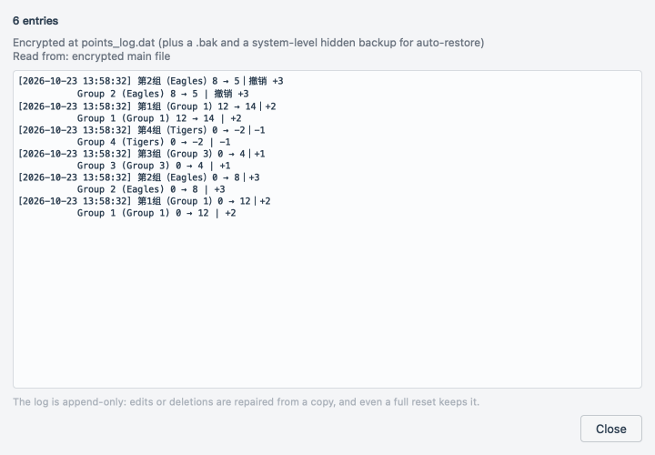
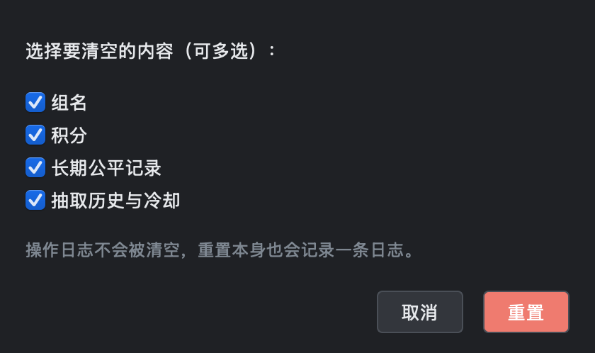
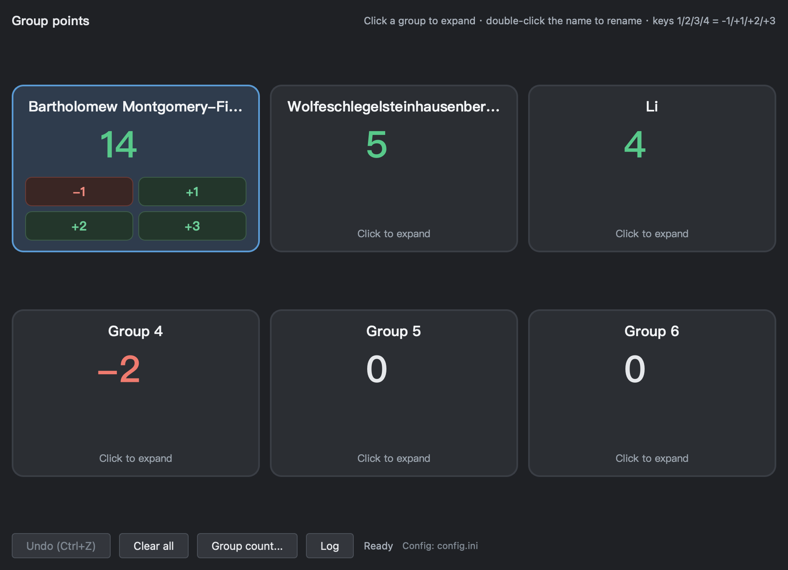
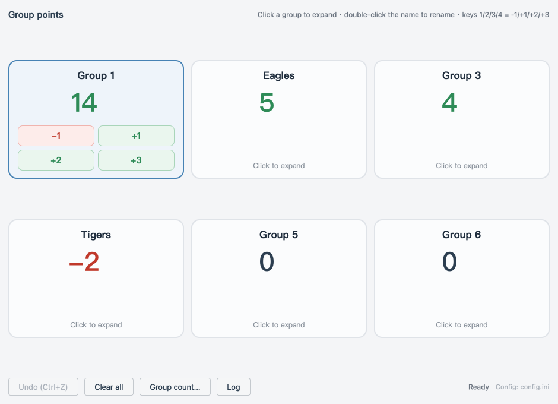
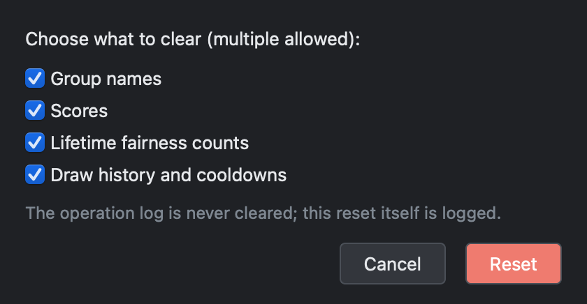
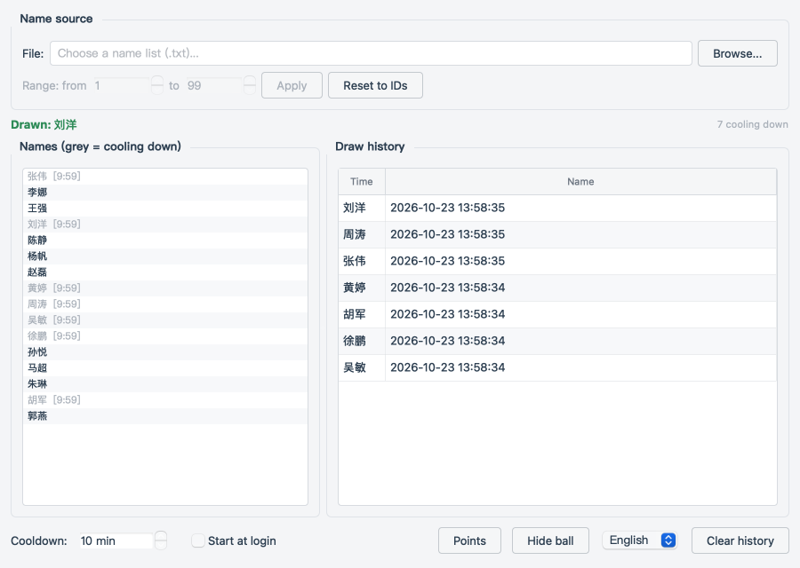
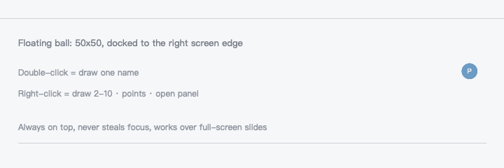
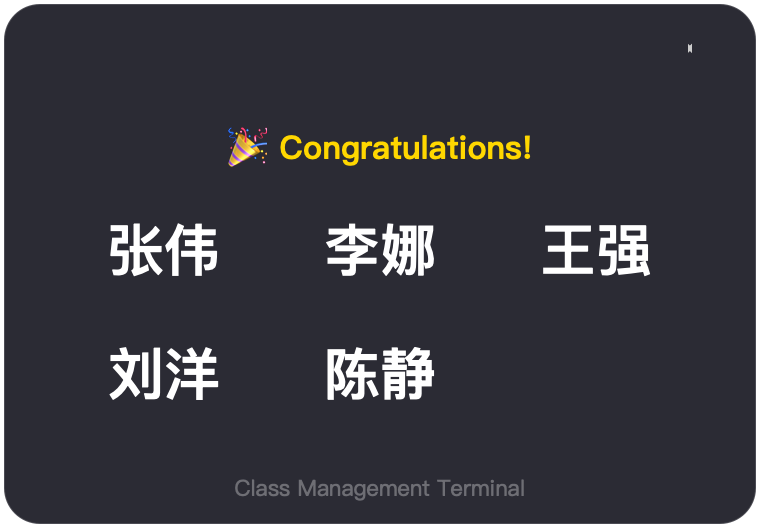

<h2 align="center">班级多用教学辅助终端</h2>

<p align="center">
  面向课堂教学的悬浮式随机点名 + 小组积分工具<br>
  <b>不遮挡课件、不抢焦点、不退出 PPT 全屏放映</b>，就能完成抽人、连抽和小组加减分。
</p>

<p align="center">
  <a href="#chinese"></a>
  &nbsp;
  <a href="#english"></a>
</p>

<p align="center">
  
  
  
</p>

<p align="center">
  
</p>

<p align="center">
  <sub>本页中英双语 · This page is bilingual — 点上方徽章或下方链接切换 / use the badges or links above to switch</sub>
</p>

---

<a id="chinese"></a>

# 中文

<p align="right"><a href="#english">English version ↓</a></p>

## 目录

- [截图](#截图)
- [它解决什么问题](#它解决什么问题)
- [功能特性](#功能特性)
- [快速开始](#快速开始)
- [使用说明](#使用说明)
- [界面语言（中文 / English）](#界面语言中文--english)
- [数据与安全](#数据与安全)
- [核心设计：为什么不用纯随机](#核心设计为什么不用纯随机)
- [跨平台支持](#跨平台支持)
- [打包](#打包)
- [项目结构](#项目结构)
- [测试](#测试)
- [开发注意事项](#开发注意事项)
- [常见问题](#常见问题)
- [已知限制](#已知限制)
- [许可证](#许可证)

---

## 截图

> 下面的图由 `python tools/make_screenshots.py` 直接抓取真实控件生成，界面改动后重跑一次即可同步，不是手绘示意图。

### 小组积分面板

单击卡片展开操作按钮，双击组名重命名，支持撤销与快捷键。底栏「操作日志」是日志的唯一入口。


### 操作日志

每次积分变动自动记录一条，加密存储、只增不减、可自动回档。只读，不可编辑。
每条记录同时保存中英两版：

| 中文 | English |
|---|---|
|  |  |

### 悬浮球


### 抽选结果弹窗

连抽只弹一个窗口，多个名字同时滚动、一起揭晓，`✕` 关闭或 5 秒后自动消失。


### 彻底重置：选择清空范围

组名 / 积分 / 长期公平记录 / 抽取历史可分别勾选，点「重置」后再二次确认。



### 管理面板

名单加载、冷却倒计时、抽取历史、开机自启动、托盘入口。


### 深色模式

界面跟随系统外观（macOS / Windows 均可），不是把浅色主题硬套一遍：
卡片、按钮、表格、日志区都有各自的深色配色，文字与背景保持足够对比度。
也可用环境变量强制预览：`CLASSMANAGE_THEME=dark python main.py`。

| 积分面板 | 操作日志 |
|---|---|
|  |  |


---

## 它解决什么问题

在小组合作学习、课堂竞赛、随机点名、任务分配这类场景里，老师经常需要：

- 随机抽一个人回答问题；
- 一次抽 2~10 人做分组活动或任务分配；
- 给各学习小组加/减分，记录课堂表现；
- **在 PPT 全屏放映中完成以上操作，不退出课件、不切屏、不打断讲课**。

程序默认以一颗 50×50 的悬浮球停在屏幕右侧：双击抽人，右键连抽 / 开积分面板 / 开管理面板。所有关键窗口置顶但不抢焦点，弹窗自动关闭，关闭积分面板也不会退出程序 —— 老师可以一直留在 PPT 全屏里，像用遥控器一样完成课堂互动。

### 核心特点

| 特点 | 说明 |
|---|---|
| **不挡课件** | 悬浮球只有 50×50，默认贴屏幕右侧边缘，可拖到任意位置 |
| **无需退出课件** | 悬浮球强制置顶（Windows 用 `SetWindowPos(HWND_TOPMOST)`；macOS 设置 NSWindow 层级与 Space 行为），可覆盖在 PPT 之上 |
| **不抢焦点** | 悬浮球与弹窗使用 `Qt.WindowDoesNotAcceptFocus`，不打断键盘输入与 PPT 操作 |
| **公平抽选** | 不是 `random.choice`，而是「加权少抽优先 + 每人冷却」，长期看每人被抽次数更均衡 |
| **积分防篡改** | AES-256-GCM 加密 + 三级自动回档，学生改文件改不动分数 |
| **常驻托盘** | 关闭主窗口/积分面板都不退出，只有托盘菜单「退出」才结束进程 |

---

## 功能特性

### 课堂操作（不打断讲课）

- 双击悬浮球 → 抽 1 人；右键 → 连抽 2~10 人 / 积分管理 / 打开管理面板。
- 揭晓前有滚动动画（1.8 秒），结果弹窗居中、带 `✕`、5 秒后自动关闭。
- 连抽只弹一个窗口，多个名字同时滚动、一起揭晓。
- 悬浮球与弹窗都不抢焦点。

### 学习小组积分

- 默认 6 组，可调 1~24 组；每组一张卡片。
- 单击展开 `-1 / +1 / +2 / +3`；双击组名重命名；右键清零本组。
- 支持 `Ctrl+Z` 撤销；快捷键 `1/2/3/4` 对应 `-1/+1/+2/+3`。
- 分数加密保存在 `config.dat`，重启不丢；被改坏或删掉会自动回档。
- 每次积分变动自动写入加密操作日志，底栏「操作日志」按钮只读查看；
  日志每条同时保存中英两版，切换语言后历史记录依然可读。
- 「彻底重置」会先弹出**选择清空范围**的对话框：组名 / 积分 / 长期公平记录 /
  抽取历史可分别勾选，确认后再二次确认，避免误伤不需要清的数据。
- 改组数会整段重置组名与分数（换组数就是换了一套分组，旧分数没有可挂靠的组）。

### 公平抽选

- 「加权少抽优先」：历史累计被抽次数越少，权重越高。
- 最近被抽中的人临时降权，避免连庄。
- 长期次数存在 `stats.ini`，重启仍生效。
- 课前「清空历史」只清历史与冷却，保留长期次数；只有「彻底重置」才清零长期次数。

### 管理面板

- 名单来源：`.txt` 文件（一行一个名字，支持 `#` 注释），或按数字范围生成（默认 1~99）。
- 名单列表显示冷却倒计时，冷却中的学生变灰。
- 抽取历史表、每人冷却时间（1~60 分钟，默认 10）。
- 开机自启动开关（Windows 写注册表 Run 项；macOS 写 LaunchAgent）。
- 托盘菜单：显示主窗口 / 积分管理 / 抽取名字 / 彻底重置 / 退出。

---

## 快速开始

### 环境要求

- Windows 10 及以上（主要目标平台）、macOS 11 及以上；Linux 未验证。
- Python 3.10+、PyQt5、cryptography（仅源码运行需要）。

```bash
pip install -r requirements.txt
```

### 源码运行

```bash
python main.py
```

不想留控制台窗口：

```bash
pythonw main.py          # Windows：pythonw 不弹控制台
```

macOS 直接 `python main.py` 即可；想做成双击启动的程序见 [打包](#打包)。

首次启动会在程序目录旁生成加密配置；没有历史名单时会自动生成 1~99 的数字名单。

### 下载可运行版本

在 **GitHub Releases** 下载（若尚未发布，见 [打包](#打包) 自行构建）。

---

## 使用说明

### 悬浮球

| 操作 | 效果 |
|---|---|
| 左键双击 | 抽 1 个人 |
| 左键拖动 | 移动悬浮球 |
| 右键 | 菜单：连抽 2~10 人 / 积分管理 / 打开管理面板 / 抽取名字 / 彻底重置 / 退出 |
| 抽中时 | 短暂闪金色 |

### 积分面板

| 操作 | 效果 |
|---|---|
| 单击卡片 | 展开操作按钮 |
| 双击组名 | 重命名 |
| 右键卡片 | 清零本组积分 |
| `Ctrl+Z` | 撤销最近一次加减分 |
| `1 / 2 / 3 / 4` | `-1 / +1 / +2 / +3` |
| 「小组数量...」 | 改组数（需二次确认，会清空组名与分数） |
| 「全部清零」 | 所有小组归零（不可撤销） |
| 「操作日志」 | 打开只读日志查看器（唯一入口，中英双语逐条显示） |

小组名支持任意长度的名字（外国人名可能几十个字符）：卡片和抽选弹窗会按宽度
自动省略显示「…」，完整名字放在 tooltip 里，鼠标悬停可见；抽选弹窗还会先缩小
字号、再把窗口宽度限制在屏幕内，不会把名字顶出屏幕。



上图同时展示了英文模式下的默认组名：只改过名字的小组显示自定义名，
没改过的显示 `Group 4/5/6`。

### 管理面板

- 「名单来源」：浏览 `.txt` 名单，或按数字范围生成；「重置为学号」恢复默认 1~99。
- 「每人冷却」：1~60 分钟。
- 「开机自启动」：写入当前用户的自启动项。
- 「隐藏悬浮球」：临时隐藏/显示悬浮球。
- 「清空历史」：清空抽取历史与冷却，**保留**长期公平计数。
- 托盘「彻底重置...」：组名、积分、长期公平记录、抽取历史全部回到出厂状态。

---

## 界面语言（中文 / English）

界面、对话框、托盘/悬浮球菜单、操作日志全部支持中英双语。

- **切换方式**：管理面板底栏的语言下拉框（`中文` / `English`）。切换后会询问
  **是否立即重启**；选「是」会自动退出并重新拉起一个新进程，选「否」则下次启动生效。
- **生效时机**：界面文字不做热替换（Qt 没有 `retranslateUi`），因此需要重启。
- **默认值**：首次运行跟随系统语言；之后以保存的选择为准。
- **临时覆盖**：`CLASSMANAGE_LANG=zh|en` 环境变量，优先级最高，不写回设置
  （截图与自动化测试用）。
- **操作日志**：每条记录同时保存中文和 English 两个版本，查看器里两行一起显示，
  所以切换语言不会让历史记录变成看不懂的语言。
- **默认组名跟随语言**：还叫默认名的小组会显示为当前语言的默认名
  （中文 `第一组…` ↔ 英文 `Group 1…`）；**老师自定义过的组名保持原样**，
  不会被切换语言改写。日志内容同样不会被改写。

| 中文界面 | English UI |
|---|---|
|  |  |



底栏右侧的下拉框就是语言开关：



`tools/` 下的脚本统一输出英文，便于把日志贴到 issue 或 CI 里。

---

## 数据与安全

积分和操作日志都是**防篡改存储**：同一份数据有四个副本，读取时逐级回退。

| 文件 / 位置 | 角色 | 程序行为 |
|---|---|---|
| `config.dat` | 积分主数据源（AES-256-GCM） | 读 + 写 |
| `config.dat.bak` | 同目录加密备份 | 读（回档）+ 写 |
| `QSettings` 隐蔽备份 | Windows 注册表 / macOS plist / Linux conf | 读（回档）+ 写 |
| `config.ini` | 明文查看副本 | **只写，永不读** |

积分读取顺序：

```text
config.dat → config.dat.bak → QSettings 隐蔽备份 → 旧版明文（一次性迁移）→ 默认值
```

任何一级读成功，都会用成功的数据把前面的副本重新写一遍（自动修复）。

### `config.dat` / `config.dat.bak`

- 内容为 `nonce(12B) + 密文 + GCM tag(16B)`，用记事本打开是乱码；
- GCM 是认证加密：改任何一个字节，解密必然失败，程序随即回档到下一级副本。

### 密钥

- 首次运行自动生成 32 字节密钥到 `~/.classmanage_key`（macOS/Linux 权限 `600`）；
- 不硬编码在源码里，随用户账户隔离；
- 密钥文件写不进去时程序不会崩，会降级为「本次运行临时密钥」并把原因记在
  `crypto_utils.key_error()` 里（可用 `tools/config_crypto_check.py` 排查）。

### `config.ini`（查看副本）

每次保存重新生成，首行是 `# 仅供查看，修改无效`。**程序从不读取它**，手工改它不会影响分数，想改请用界面。

### `QSettings` 隐蔽备份

同一份密文再存一份到系统级位置，学生不易找到、也不好删：

```text
Windows : HKCU\Software\YourOrg\ClassManageSystem
macOS   : ~/Library/Preferences/com.yourorg.ClassManageSystem.plist
Linux   : ~/.config/YourOrg/ClassManageSystem.conf
```

用 `QSettings` 而非 `winreg`，一套代码三平台通用，macOS 下不会 `ModuleNotFoundError`。写入失败静默忽略，绝不影响主流程。

### `points_log.dat`（操作日志）

- 自动记录：加/减分、撤销、清零本组、全部清零、改组数、彻底重置；
- 分数没变化时不记录；组名重命名不记录（不是积分变动）；
- **只增不减**：最多保留最近 400 条（`seq` 是历史累计条数并持续增长），因此
  「哪份副本的 `seq` 最大就用哪份」—— 拿旧密文覆盖主文件这种**回滚式篡改**也会被自动修回；
- 「彻底重置」不清空日志，只追加一条标记：审计记录不能靠一个按钮抹掉；
- 磁盘上**没有明文副本**，唯一查看入口是积分面板的「操作日志」按钮；
- 每条记录存 `(时间, 中文, English)` 三元组，旧版纯文本记录也能继续读取
  （英文侧留空，只显示原文）。

### `stats.ini`

长期抽取次数，与配置同目录，明文存储（不含积分）。

```ini
[counts]
张三 = 5
李四 = 3
```

独立成文件的原因：若与积分放在一起，课前「清空历史」会连带清掉长期次数，加权就退化成"每节课各自独立随机"。

### `crash.log`

与配置同目录，记录 Python traceback 与原生崩溃，最多 200 条。**0 字节表示没有崩溃**。

### 数据放在哪

配置与日志写在**程序所在目录**旁（打包后是 EXE / `.app` 同级目录，不在 `.app` 包内部）；若该目录不可写，则整体回退到：

```text
Windows        : %APPDATA%\ClassTerminal2411\
macOS / Linux  : ~/ClassTerminal2411/
```

---

## 核心设计：为什么不用纯随机

`random.choice` 对「每一次」抽取是均匀的，但对「每个学生一学期」不是。40 人里出现有人被抽两次、有人一次没抽到是很常见的聚集现象，学生看到的就是「老师老抽他」。

因此 `NameEngine` 使用加权少抽优先模型：

```text
weight = (max_count - count + 1) ** FAIRNESS_STRENGTH
         * recency_penalty
```

参数位于 `namepicker/name_engine.py` 顶部：

| 参数 | 默认值 | 说明 |
|---|---:|---|
| `FAIRNESS_STRENGTH` | `4.0` | 向最少被抽者倾斜的强度。调到 9 会接近固定轮换。 |
| `RECENT_GAP` | `4` | 最近 N 次内被抽中过则降低权重。 |
| `RECENT_PENALTY` | `0.35` | 刚被抽中者的权重下限，避免连庄。 |
| `MIN_WEIGHT` | `0.01` | 保证每个有资格的人仍有可能被抽中。 |

两个语义不同的重置：

- `clear_history()`：清空抽取历史与冷却，**保留**长期累计次数 —— 对应教师课前的「清空历史」。
- `reset_fairness()`：连同长期累计次数一起清零 —— 用于新学期、换班级或「彻底重置」。

修改公平性参数后建议重跑基准：

```bash
python tools/fairness_benchmark.py
python tools/fairness_burnin.py
```

---

## 跨平台支持

| 能力 | Windows | macOS | Linux |
|---|---|---|---|
| 抽选 / 积分 / 日志 | ✅ | ✅ | 未验证 |
| 盖住全屏应用 | ✅ `SetWindowPos` | ✅ accessory 策略 + 浮层属性（已实测） | 未验证 |
| 托盘 / 菜单栏图标 | ✅ 彩色托盘图标 | ✅ 模板图；**菜单栏自动隐藏时不显示** | 未验证 |
| 浅色 / 深色模式 | ✅ 跟随系统 | ✅ 跟随系统 | ✅ 跟随系统 |
| 系统级隐蔽备份 | ✅ HKCU 注册表 | ✅ `~/Library/Preferences` plist | ✅ `~/.config` |
| 悬浮球置顶 | ✅ `SetWindowPos(HWND_TOPMOST)` | ✅ 层级 + `CanJoinAllSpaces`/`FullScreenAuxiliary`/`Stationary` | 未验证 |
| Dock 图标 | — | ❌ 无（accessory 策略的代价，见下） | — |
| 开机自启动 | ✅ 注册表 Run 项 | ✅ LaunchAgent | ❌（返回失败） |
| 冻结后数据位置 | ✅ EXE 同级目录 | ✅ `.app` **同级**目录（不在包内） | — |

设计约定：**不直接 `import winreg`**（改为 `try/except ImportError`），平台专有调用全部包在 `try/except` 里并静默降级；存储层统一走 PyQt5 自带的 `QSettings`；配色与字体统一由 `namepicker/theme.py` 提供。

---

## 打包

> **PyInstaller 不支持交叉编译**：在 macOS 上只能打出 macOS 程序，`.exe` 必须在 Windows 上打包（本地 Windows 或 CI）。

### Windows —— 方式一：GitHub Actions（推荐）

推送即自动打包，产物在 Actions 页面下载：

```bash
git push origin main                    # 触发 .github/workflows/build-windows.yml
git tag v1.0.0 && git push origin v1.0.0   # 打 tag 会自动建 Release 并附上 EXE
```

CI 会依次跑：`tools/windows_check.py`（平台自检，同时验证注册表隐蔽备份与 Win32 置顶是否真的可用）→ 存储/日志验收 → PyInstaller 打包 → 上传 `ClassManageSystem-windows-x64` 产物。**自检失败会中断出包**，所以能下到 EXE 就意味着这些功能在真 Windows 上实测过。

### Windows —— 方式二：任意一台 Windows

```bat
packaging\windows\build.bat
```

脚本会自动建 `.venv-build` 虚拟环境、装依赖、跑自检、打包，产物 `dist\ClassManageSystem.exe`。默认走清华 PyPI 镜像（国内下载 PyQt5 快得多），可换源：

```bat
packaging\windows\build.bat official                                 :: 官方 PyPI
packaging\windows\build.bat https://mirrors.aliyun.com/pypi/simple/  :: 阿里
```

镜像只作用于这条命令，**不写 `pip.ini`、不改系统全局 pip 配置**。

### macOS

```bash
packaging/macos/build.command        # 双击也可以
```

产物 `dist/ClassManageSystem.app`。打出来是**当前 CPU 架构**的原生程序（Apple Silicon 上是 arm64；要通用需 universal2 的 Python + PyQt5）。

### 产物说明

- 单文件窗口程序，目标机不需要装 Python；
- 配置与日志写在 EXE / `.app` 同级目录（只读目录则回退 `%APPDATA%\ClassTerminal2411`），密钥在用户主目录；
- **未做代码签名**：Windows 首次运行 SmartScreen 会提示「未知发布者」，点「更多信息 → 仍要运行」；macOS 拷给别人后首次需**右键 → 打开**。

---

## 项目结构

```text
.
├── main.py                          # 入口：组装组件、连接信号、进入事件循环
├── requirements.txt
├── names.txt                        # 示例名单
├── docs/images/                     # README 截图（由 tools/make_screenshots.py 生成）
│
├── namepicker/                      # 主程序包
│   ├── _init_.md                    # 包内文件职责说明
│   ├── config_store.py              # config.dat：加密配置 + 三级回档
│   ├── crypto_utils.py              # AES-256-GCM 与 ~/.classmanage_key 密钥管理
│   ├── log_store.py                 # points_log.dat：加密操作日志 + 防回滚
│   ├── backup_store.py              # QSettings 系统级隐蔽备份（跨平台）
│   ├── stats_store.py               # stats.ini：长期抽取次数
│   ├── name_engine.py               # 抽取逻辑：公平加权、冷却、历史
│   ├── floating_ball.py             # 悬浮球（含跨平台强制置顶）
│   ├── draw_popup.py                # 结果弹窗与滚动动画
│   ├── points_window.py             # 积分面板 + 操作日志查看器
│   ├── main_window.py               # 管理面板、托盘、开机自启动、语言切换
│   ├── i18n.py                      # 中英双语：tr() / both() / Qt 翻译装载
│   ├── widgets.py                   # ElidedLabel：长名字按宽度省略 + tooltip 全名
│   ├── restart.py                   # 切换语言后的「立即重启」（源码/打包两种参数）
│   ├── wipe_dialog.py               # 彻底重置：勾选清空范围 + 二次确认
│   ├── wipe_service.py              # 按勾选项逐项清空（可单测）
│   ├── theme.py                     # 浅/深色配色 token、跨平台字体、托盘图标
│   ├── macos_window.py              # macOS 激活策略 + 全屏浮层
│   ├── single_instance.py           # 单实例守护（QLocalServer 判活）
│   └── crash_log.py                 # 崩溃日志
│
├── packaging/
│   ├── windows/                     # PyInstaller spec、图标、版本信息、build.bat
│   ├── macos/                       # PyInstaller spec、icns、build.command
│   └── make_icon.py                 # 生成 Windows 图标（Qt 渲染，无需 Pillow）
│
├── tools/                           # 测试与开发脚本（不随程序分发）
│   ├── config_check.py              # 存储往返测试（不依赖 Qt）
│   ├── config_crypto_check.py       # 加密存储 / 篡改回档 / 迁移 自检
│   ├── log_crypto_check.py          # 操作日志：自动记录 / 篡改回档 / 防回滚
│   ├── windows_check.py             # Windows 平台自检（注册表 / 置顶 / 编码 / 占用）
│   ├── macos_check.py               # macOS 平台自检（菜单栏 / 浮层 / 深色 / 全屏覆盖）
│   ├── _fullscreen_helper.py         # 自检用：进入原生全屏的辅助进程
│   ├── smoke_test.py                # GUI 冒烟测试
│   ├── group_count_stress.py        # 小组数量功能 + 300 轮压力
│   ├── make_screenshots.py          # 生成 docs/images 下的 README 截图（中/英、深/浅）
│   ├── wipe_check.py                # 彻底重置的勾选与逐项清空测试
│   ├── i18n_check.py                # 双语切换 / 持久化 / 双语日志测试
│   ├── fairness_burnin.py           # 1 万次单抽烧机 + χ² 检验
│   ├── fairness_benchmark.py        # 公平性调参基准
│   ├── reset_fairness_benchmark.py  # 教师清空历史工作流模拟
│   ├── weighting_demo.py            # 新旧算法分布对比
│   ├── repro_quit.py                # 「关闭面板导致退出」最小复现
│   └── _settings_isolation.py       # 测试用的 QSettings 命名空间隔离
│
└── .github/workflows/build-windows.yml   # CI：x64 Windows 打包
```

---

## 测试

所有测试从项目根目录运行。

```bash
python tools/config_check.py           # 最快，不依赖 Qt：存储读写/合并/清零/重置
python tools/config_crypto_check.py    # 加密存储：乱码、手改无效、篡改/删除回档、迁移
python tools/log_crypto_check.py       # 操作日志：自动记录、无明文副本、防回滚、只增不减
python tools/windows_check.py          # 平台自检（在 Windows 上才跑真实分支）
python tools/macos_check.py            # 平台自检（菜单栏 / 浮层 / 深色 / 激活策略 / 模态框层级）
python tools/macos_check.py --fullscreen   # 额外跑一次「真·原生全屏」覆盖测试
python tools/smoke_test.py             # GUI 冒烟：信号连接、布局、落盘、撤销、连抽
python tools/group_count_stress.py     # 小组数量功能 + 300 轮压力
python tools/wipe_check.py             # 彻底重置：勾选项与逐项清空行为
python tools/i18n_check.py             # 双语：默认组名、重启参数、长名字省略、双语日志
```

- `config_crypto_check` / `log_crypto_check` 会在临时 HOME 下运行，**不碰你的真实数据**；装了 PyQt5 时还会验证真实的 QSettings 隐蔽备份。
- 冒烟测试构造 `MainWindow` 会读写真实注册表（Windows），脚本会先备份开机自启动项、跑完还原；macOS/Linux 自动跳过。
- 测试统一使用隔离的 QSettings 命名空间，不会污染真实注册表 / plist。

公平性专项：

```bash
python tools/fairness_burnin.py        # 冷启动长跑、偏斜追赶、χ² 检验、连庄率…
python tools/fairness_benchmark.py     # 对比 FAIRNESS_STRENGTH = 2/4/6/9 与纯随机
python tools/reset_fairness_benchmark.py   # 模拟每节课前「清空历史」的工作流
python tools/weighting_demo.py         # 新旧算法分布对比
```

重新生成 README 截图：

```bash
python tools/make_screenshots.py                          # 浅色（默认）
CLASSMANAGE_THEME=dark python tools/make_screenshots.py   # 深色，输出 *-dark.png
```

截图脚本会把窗口移到屏幕外再 `grab()`，不会在你桌面上闪；数据用临时目录，
不碰真实配置。

---

## 开发注意事项

- 改 `name_engine.py` 顶部公平性参数后，请重跑公平性基准与烧机测试。
- `clear_history()` 与 `reset_fairness()` 语义不同，改之前务必确认。
- `points_window.py` 中旧卡片销毁前必须先 `hide()`，否则会闪成独立顶层窗口。
- 积分卡片样式按 `(选中态, 颜色)` 缓存，避免连续点击时高频重刷。
- 徽标定时器只创建一次并复用，不要在每次点击时重建 `QTimer`。
- 正式运行没有控制台时，排错先看 `crash.log`。
- 单实例守护**不能只看 `QSharedMemory`**：Unix 上共享内存段不随进程消失而释放，
  被 `kill -9` 后残留的孤儿段会让下次启动永远静默退出。现在以 `QLocalServer`
  能否连通作为存活判据，共享内存仅作兜底。
- 打包相关：`config_store._app_dir()` 对 `.app` 有专门处理，避免把数据写进应用包内部；
  Windows 的 `.bat` 必须是**纯 ASCII + CRLF**（`.gitattributes` 已强制 `eol=crlf`），
  且 `REM` 行里不能出现未配对的圆括号 —— cmd 的括号配对统计会因此从行中间截断命令。
- **浮层会盖住对话框（踩过的坑）**：积分面板/结果弹窗为了盖住全屏 PPT 被设成
  `NSStatusWindowLevel(25)`，而模态对话框（改名、确认框）默认是
  `NSModalPanelWindowLevel(8)` —— 对话框被面板盖住、模态循环还在等点击，
  表现就是「点改名后整个程序假死」。修复见 `macos_window.install_dialog_raiser()`：
  应用级事件过滤器把所有 `QDialog` 抬到 level 26 并置前（`tools/macos_check.py`
  有回归测试，会对比两者的 level 与前后顺序）。

---

## 常见问题

### 双击图标没反应，进程一闪就退？

旧版本的单实例实现会在共享内存残留后永久拒绝启动（见「开发注意事项」）。当前版本已改为
`QLocalServer` 判活，被强杀后能正常重启。若仍复现，先确认没有另一个实例在跑：

```bash
pgrep -fl ClassManageSystem        # macOS
tasklist | findstr ClassManage     # Windows
```

### 关闭积分面板后程序消失了？

已修复，`main.py` 中设置了 `app.setQuitOnLastWindowClosed(False)`。复现脚本：`python tools/repro_quit.py`。

### 分数没有保存？

检查程序所在目录（放 `config.dat` 的那个目录）是否可写；只读时会自动回退到
`%APPDATA%\ClassTerminal2411\`（macOS/Linux：`~/ClassTerminal2411/`）。
`python tools/config_crypto_check.py` 可以定位是密钥、密文还是目录权限的问题。

### 学生改了 `config.ini` 的分数，为什么没生效？

因为程序从不读取 `config.ini`，它每次保存都会被加密数据覆盖。真正生效的是 `config.dat`
（外加 `.bak` 与系统级隐蔽备份）。改 `config.dat` 也一样：GCM 认证加密会让解密失败，
程序自动从备份回档。想删数据也不行 —— 删掉主文件会从 `.bak` 恢复，两个都删会从
QSettings 隐蔽备份恢复。

### 操作日志能删吗？

不能，这是设计。日志只增不减，「彻底重置」也只追加一条标记。想留档可以截图或复制
查看器里的文本。

### 「清空历史」后公平性会失效吗？

不会。它只清历史与冷却，长期次数保留在 `stats.ini`；只有「彻底重置」才清零长期次数。

### 为什么连抽人数不足？

因为部分学生仍在冷却中。连抽只从当前可用名单里抽，返回实际抽到的人数并给出提示。

### 程序无提示退出怎么办？

看 `crash.log`。0 字节通常说明不是崩溃（可能被强杀或正常退出）。

### 打包时报 `'xxx' 不是内部或外部命令`？

`.bat` 被存成了 UTF-8/LF 或 `REM` 行里有未配对括号。本仓库的 `build.bat` 已修正并加了
`.gitattributes`；自行改动时请保持纯 ASCII + CRLF。

---


## 已知限制

- **未做代码签名/公证**：Windows 有 SmartScreen 提示，macOS 拷贝到别的机器需右键打开。
- **架构跟随构建机**：Apple Silicon 上打出 arm64 的 `.app`，Intel Mac 不能跑；
  Windows CI 产出 x64。
- **macOS 全屏覆盖靠「应用激活策略」**：窗口层级再高也没用 —— regular 应用自己占着
  一个桌面 Space，别的 App 进全屏后它压根不在那个 Space 里。本程序启动时会切到
  **accessory** 策略（`LSUIElement`，与 Alfred / Raycast 相同），窗口才能加入
  全屏 Space。代价是**没有 Dock 图标**；入口改为悬浮球 + 菜单栏图标。
  已用 `CGWindowList onScreenOnly` 对真实原生全屏做过实测：
  `python tools/macos_check.py --fullscreen` 会显示「悬浮球可以盖在原生全屏应用之上 ✅」。
- **macOS 菜单栏图标**：图标本身是模板图、状态项也确实创建了（自检会验证
  `NSStatusBarWindow`）。如果系统开启了「自动隐藏菜单栏」（`_HIHideMenuBar=1`），
  菜单栏收起时状态项按系统设计就不显示 —— 这不是程序问题。此时可用悬浮球右键菜单，
  里面已包含托盘的全部动作（抽取名字 / 积分管理 / 打开面板 / 彻底重置 / 退出）。
  想要常驻可见，请在 系统设置 → 外观（或桌面与程序坞）关闭「自动隐藏菜单栏」。
- **密钥与账户同权限**：密钥在用户主目录，若教师与学生共用同一个系统登录账户，
  学生理论上可以读取密钥。这是「用户级密钥」方案的固有边界。
- **Linux 未验证**：代码有平台守卫不会崩，但托盘/置顶行为未测试。

---

## 许可证

MIT License

Copyright (c) 2026 Gentole Lee

Permission is hereby granted, free of charge, to any person obtaining a copy
of this software and associated documentation files (the "Software"), to deal
in the Software without restriction, including without limitation the rights
to use, copy, modify, merge, publish, distribute, sublicense, and/or sell
copies of the Software, and to permit persons to whom the Software is
furnished to do so, subject to the following conditions:

The above copyright notice and this permission notice shall be included in all
copies or substantial portions of the Software.

THE SOFTWARE IS PROVIDED "AS IS", WITHOUT WARRANTY OF ANY KIND, EXPRESS OR
IMPLIED, INCLUDING BUT NOT LIMITED TO THE WARRANTIES OF MERCHANTABILITY,
FITNESS FOR A PARTICULAR PURPOSE AND NONINFRINGEMENT. IN NO EVENT SHALL THE
AUTHORS OR COPYRIGHT HOLDERS BE LIABLE FOR ANY CLAIM, DAMAGES OR OTHER
LIABILITY, WHETHER IN AN ACTION OF CONTRACT, TORT OR OTHERWISE, ARISING FROM,
OUT OF OR IN CONNECTION WITH THE SOFTWARE OR THE USE OR OTHER DEALINGS IN THE
SOFTWARE.

<p align="right"><a href="#english">English version ↓</a> · <a href="#chinese">回到顶部</a></p>

---
---

<a id="english"></a>

# English

<p align="right"><a href="#chinese">中文版 ↑</a></p>

A floating random-name picker with group scoring for classroom teaching.
**It never covers your slides, never steals focus, and never drops out of a
full-screen presentation** — you can pick students, draw several at once, and add
or subtract group points while PowerPoint stays in full screen.

## Contents

- [Screenshots](#en-screenshots)
- [The problem it solves](#en-problem)
- [Features](#en-features)
- [Quick start](#en-quick-start)
- [Usage](#en-usage)
- [UI language (中文 / English)](#en-language)
- [Data and security](#en-data)
- [Core design: why not plain random](#en-design)
- [Platform support](#en-platform)
- [Packaging](#en-packaging)
- [Project layout](#en-layout)
- [Tests](#en-tests)
- [Development notes](#en-dev-notes)
- [FAQ](#en-faq)
- [Known limitations](#en-limits)
- [License](#en-license)

---

<a id="en-screenshots"></a>

## Screenshots

> Every image below is captured from the real widgets by
> `python tools/make_screenshots.py`. Re-run it after UI changes instead of drawing
> mockups by hand.

### Group points panel

Click a card to reveal its action buttons, double-click a group name to rename it;
undo and keyboard shortcuts are supported. The "Log" button at the bottom is the only
entry point to the operation log.


### Operation log

One encrypted record per score change — append-only, auto-repaired, read-only.
Every entry stores both Chinese and English:

| Chinese | English |
|---|---|
|  |  |

### Floating ball



### Draw result popup

A multi-draw opens a single window where all names roll and are revealed together;
close it with `✕` or let it disappear after 5 seconds.



### Full reset: choose what to clear

Group names, scores, lifetime fairness counts and draw history can be selected
independently; a second confirmation follows when you press "Reset".


### Management panel

Name loading, cooldown countdown, draw history, start at login and the tray entry.


### Dark mode

The UI follows the system appearance on both macOS and Windows. This is not a light
theme forced into dark: cards, buttons, tables and the log area each have their own
dark palette with sufficient text contrast. Force it for a preview with
`CLASSMANAGE_THEME=dark python main.py`.

| Points panel | Operation log |
|---|---|
|  |  |


---

<a id="en-problem"></a>

## The problem it solves

In group work, classroom competitions, random questioning and task assignment,
teachers constantly need to:

- pick one student at random to answer;
- pick 2–10 students at once for group activities or task assignment;
- add or subtract points for learning groups and record classroom performance;
- **do all of the above while PowerPoint is in full-screen presentation mode**,
  without leaving the slides, switching screens or interrupting the lesson.

The app lives as a 50×50 floating ball docked to the right edge of the screen:
double-click to draw one name, right-click to draw several, open the points panel or
the management panel. Every important window stays on top without stealing focus,
popups dismiss themselves, and closing the points panel does not quit the app — the
teacher stays in full-screen slides and interacts with the app like a remote control.

### Highlights

| Highlight | Details |
|---|---|
| **Never covers the slides** | The ball is just 50×50, docked to the right edge by default and draggable anywhere |
| **No need to leave the slides** | The ball is forced on top (`SetWindowPos(HWND_TOPMOST)` on Windows; NSWindow level and Space behaviour on macOS), so it sits above PowerPoint |
| **Never steals focus** | The ball and popups use `Qt.WindowDoesNotAcceptFocus`, so typing and slide control keep working |
| **Fair drawing** | Not `random.choice`, but weighted least-drawn-first plus a per-person cooldown, so counts even out over a term |
| **Tamper-resistant scores** | AES-256-GCM encryption plus a three-level fallback; editing files does not change the scores |
| **Lives in the tray** | Closing the main window or the points panel does not quit; only "Quit" in the tray menu does |
| **Bilingual** | UI, dialogs and the operation log are bilingual and switchable |

---

<a id="en-features"></a>

## Features

### Classroom actions (without interrupting the lesson)

- Double-click the ball to draw one name; right-click to draw 2–10, open the points
  panel, or open the management panel.
- A 1.8-second rolling animation precedes the reveal; the result popup is centred,
  has a `✕`, and closes after 5 seconds.
- A multi-draw opens a single window where every name rolls and is revealed together.
- Neither the ball nor the popups steals focus.

### Group scoring

- 6 groups by default, adjustable from 1 to 24; one card per group.
- Click to reveal `-1 / +1 / +2 / +3`; double-click the name to rename; right-click to
  reset that group.
- `Ctrl+Z` undoes the last change; the keys `1/2/3/4` map to `-1/+1/+2/+3`.
- Scores are encrypted in `config.dat` and survive restarts; corrupted or deleted files
  are restored automatically.
- Every change is appended to the encrypted operation log, readable through the "Log"
  button. Each entry stores both Chinese and English, so history stays readable after
  switching language.
- "Full reset" first asks **which parts to clear** — group names, scores, lifetime
  fairness counts and draw history are selectable independently — followed by a second
  confirmation, so data you want to keep is never cleared by accident.
- Changing the group count resets all names and scores (a different group count is a
  different set of groups; the old scores have nothing to attach to).

### Fair drawing

- "Weighted least-drawn first": the fewer times a student has been drawn overall, the
  higher their weight.
- Students drawn recently get a temporary penalty to avoid streaks.
- Lifetime counts live in `stats.ini` and survive restarts.
- "Clear history" before a lesson only clears history and cooldowns; only a full reset
  zeroes lifetime counts.

### Management panel

- Name source: a `.txt` file (one name per line, `#` comments supported), or a generated
  numeric range (1–99 by default).
- The name list shows cooldown countdowns; cooling-down students are greyed out.
- Draw history table and per-person cooldown (1–60 minutes, default 10).
- Start-at-login toggle (registry Run key on Windows, LaunchAgent on macOS).
- Tray menu: Show window / Points / Draw a name / Full reset / Quit.

---

<a id="en-quick-start"></a>

## Quick start

### Requirements

- Windows 10 or later (primary target), macOS 11 or later; Linux untested.
- Python 3.10+, PyQt5 and cryptography (only needed when running from source).

```bash
pip install -r requirements.txt
```

### Run from source

```bash
python main.py
```

To avoid a console window:

```bash
pythonw main.py          # Windows: pythonw shows no console
```

On macOS plain `python main.py` is fine; see [Packaging](#en-packaging) for a
double-clickable build.

The first run creates an encrypted config next to the program; with no saved name list,
a default list of the numbers 1–99 is generated.

### Download a ready-to-run build

Grab it from **GitHub Releases** (if nothing is published yet, see
[Packaging](#en-packaging) and build it yourself).

---

<a id="en-usage"></a>

## Usage

### Floating ball

| Action | Effect |
|---|---|
| Double-click (left) | Draw one student |
| Drag (left) | Move the ball |
| Right-click | Menu: draw 2–10 / points / open panel / draw a name / full reset / quit |
| On draw | Brief golden flash |

### Points panel

| Action | Effect |
|---|---|
| Click a card | Reveal the action buttons |
| Double-click the name | Rename the group |
| Right-click a card | Reset this group to zero |
| `Ctrl+Z` | Undo the last score change |
| `1 / 2 / 3 / 4` | `-1 / +1 / +2 / +3` |
| "Group count..." | Change the number of groups (confirmation required; clears names and scores) |
| "Clear all" | Set every group to zero (not undoable) |
| "Log" | Open the read-only log viewer (the only entry point; shows both languages) |

Group names may be arbitrarily long (foreign names are often dozens of characters):
cards and the draw popup elide them with "…" and put the full name in a tooltip. The
popup first shrinks the font, then clamps the window to the screen width, so a long name
never pushes the window off screen.


The image above also shows default group names in English mode: renamed groups keep
their custom name, untouched ones show `Group 4/5/6`.

### Management panel

- "Name source": browse a `.txt` list or generate a numeric range; "Reset to IDs"
  restores 1–99.
- "Cooldown": 1–60 minutes.
- "Start at login": writes an auto-start entry for the current user.
- "Hide ball": temporarily hide or show the ball.
- "Clear history": clears draw history and cooldowns but **keeps** lifetime fairness
  counts.
- Tray → "Full reset...": choose group names, scores, lifetime fairness counts and draw
  history individually.

---

<a id="en-language"></a>

## UI language (中文 / English)

The UI, dialogs, tray and ball menus, and the operation log are all bilingual.

- **How to switch**: the language dropdown at the bottom of the management panel
  (`中文` / `English`). You are then asked **whether to restart now**; choosing Yes quits
  and relaunches the app, choosing No applies the change on the next start.
- **When it applies**: UI strings are not swapped live (Qt has no `retranslateUi`),
  hence the restart.
- **Default**: follows the system language on first run, then the saved choice.
- **Override**: `CLASSMANAGE_LANG=zh|en` has the highest priority and is never written
  back (used by screenshots and automated tests).
- **Operation log**: every entry stores both Chinese and English and the viewer shows
  both lines, so switching language never turns history into gibberish.
- **Default group names follow the language**: groups still using a default name are
  shown in the current language (`第一组…` ↔ `Group 1…`); **names the teacher
  customised are left untouched**, as is the log content.

| Chinese UI | English UI |
|---|---|
|  |  |

The dropdown at the bottom right is the language switch:


Scripts under `tools/` always print English, so their output can be pasted into issues
or CI logs.

---

<a id="en-data"></a>

## Data and security

Scores and the operation log use **tamper-resistant storage**: four copies of the same
data with a level-by-level fallback on read.

| File / location | Role | Program behaviour |
|---|---|---|
| `config.dat` | Primary score source (AES-256-GCM) | read + write |
| `config.dat.bak` | Encrypted backup next to it | read (restore) + write |
| `QSettings` hidden backup | Windows registry / macOS plist / Linux conf | read (restore) + write |
| `config.ini` | Plain-text view copy | **write only, never read** |

Read order:

```text
config.dat → config.dat.bak → QSettings hidden backup → legacy plaintext (one-time migration) → defaults
```

Whenever a lower level succeeds, the data is written back to the levels above it
(automatic repair).

### `config.dat` / `config.dat.bak`

- Contents are `nonce(12B) + ciphertext + GCM tag(16B)`; opening it in a text editor
  shows nothing but garbage.
- GCM is authenticated encryption: changing a single byte makes decryption fail and the
  program falls back to the next copy.

### Key

- A 32-byte key is generated on first run at `~/.classmanage_key` (mode `600` on
  macOS/Linux).
- It is not hard-coded in the source and is isolated per user account.
- If the key file cannot be written the app does not crash; it degrades to a per-run key
  and records the reason in `crypto_utils.key_error()` (inspect with
  `tools/config_crypto_check.py`).

### `config.ini` (view copy)

Regenerated on every save, starting with `# 仅供查看，修改无效` ("view only, edits have
no effect"). **The program never reads it**; manual edits do not affect scores — use the
UI instead.

### `QSettings` hidden backup

A second copy of the same ciphertext in a system-level location that is hard for
students to find or delete:

```text
Windows : HKCU\Software\YourOrg\ClassManageSystem
macOS   : ~/Library/Preferences/com.yourorg.ClassManageSystem.plist
Linux   : ~/.config/YourOrg/ClassManageSystem.conf
```

Using `QSettings` instead of `winreg` keeps one code path for all three platforms and
avoids `ModuleNotFoundError` on macOS. Write failures are ignored silently and never
affect the main flow.

### `points_log.dat` (operation log)

- Automatically records: add/subtract, undo, reset one group, clear all, group-count
  change and full reset.
- Nothing is recorded when the score does not change; renaming a group is not a score
  change and is not recorded.
- **Append-only**: the last 400 entries are kept (`seq` counts all historical entries and
  keeps growing), so "the copy with the highest `seq` wins" — even a **rollback attack**
  that overwrites the main file with old ciphertext is repaired automatically.
- A full reset never clears the log, it only appends a marker: an audit trail must not be
  erasable with one button.
- There is **no plaintext copy on disk**; the only entry point is the "Log" button in the
  points panel.
- Each entry stores a `(timestamp, Chinese, English)` triple; legacy plain-text entries
  remain readable (the English side is empty and the original text is shown).

### `stats.ini`

Lifetime draw counts, in the same directory as the config, stored as plain text (no
scores).

```ini
[counts]
张三 = 5
李四 = 3
```

It is a separate file because if it lived with the scores, the pre-lesson "Clear history"
would also wipe lifetime counts and the weighting would degrade into "independent
randomness per lesson".

### `crash.log`

In the same directory as the config; records Python tracebacks and native crashes, up to
200 entries. **0 bytes means there was no crash.**

### Where data lives

Config and logs are written next to the program (for builds: the directory containing the
EXE / `.app`, never inside the `.app` bundle). If that directory is not writable,
everything falls back to:

```text
Windows        : %APPDATA%\ClassTerminal2411\
macOS / Linux  : ~/ClassTerminal2411/
```

---

<a id="en-design"></a>

## Core design: why not plain random

`random.choice` is uniform for *each draw* but not for *each student over a term*. With
40 students, someone being drawn twice while someone else is never drawn is a common
clustering effect — students perceive it as "the teacher always picks them".

`NameEngine` therefore uses a weighted least-drawn-first model:

```text
weight = (max_count - count + 1) ** FAIRNESS_STRENGTH
         * recency_penalty
```

The parameters live at the top of `namepicker/name_engine.py`:

| Parameter | Default | Meaning |
|---|---:|---|
| `FAIRNESS_STRENGTH` | `4.0` | How strongly to favour the least-drawn student. At 9 it approaches fixed rotation. |
| `RECENT_GAP` | `4` | Being drawn within the last N draws lowers the weight. |
| `RECENT_PENALTY` | `0.35` | Weight floor for the most recently drawn student, to avoid streaks. |
| `MIN_WEIGHT` | `0.01` | Every eligible student always keeps a chance. |

Two resets with different semantics:

- `clear_history()`: clears draw history and cooldowns, **keeps** lifetime counts — this
  is the teacher's pre-lesson "Clear history".
- `reset_fairness()`: also zeroes lifetime counts — for a new term, a different class, or
  a full reset.

After changing fairness parameters, re-run the benchmarks:

```bash
python tools/fairness_benchmark.py
python tools/fairness_burnin.py
```

---

<a id="en-platform"></a>

## Platform support

| Capability | Windows | macOS | Linux |
|---|---|---|---|
| Drawing / scoring / log | ✅ | ✅ | untested |
| Sits above full-screen apps | ✅ `SetWindowPos` | ✅ accessory policy + overlay attributes (verified) | untested |
| Tray / menu bar icon | ✅ colour tray icon | ✅ template image; **hidden when the menu bar auto-hides** | untested |
| Light / dark mode | ✅ follows system | ✅ follows system | ✅ follows system |
| System-level hidden backup | ✅ HKCU registry | ✅ `~/Library/Preferences` plist | ✅ `~/.config` |
| Ball always on top | ✅ `SetWindowPos(HWND_TOPMOST)` | ✅ level + `CanJoinAllSpaces` / `FullScreenAuxiliary` / `Stationary` | untested |
| Dock icon | — | ❌ none (the cost of the accessory policy, see below) | — |
| Start at login | ✅ registry Run key | ✅ LaunchAgent | ❌ (returns failure) |
| Data location when frozen | ✅ next to the EXE | ✅ **next to** the `.app` (not inside) | — |

Conventions: **never `import winreg` directly** (use `try/except ImportError`), wrap all
platform-specific calls in `try/except` with silent degradation, use PyQt5's built-in
`QSettings` for storage, and keep colours and fonts in `namepicker/theme.py`.

---

<a id="en-packaging"></a>

## Packaging

> **PyInstaller cannot cross-compile**: on macOS you only get a macOS build; the `.exe`
> must be built on Windows (locally or in CI).

### Windows — option 1: GitHub Actions (recommended)

Push to build automatically; grab the artifact from the Actions page:

```bash
git push origin main                      # triggers .github/workflows/build-windows.yml
git tag v1.0.0 && git push origin v1.0.0  # a tag builds a Release with the EXE attached
```

CI runs `tools/windows_check.py` (platform self-check, which also verifies that the
registry hidden backup and Win32 topmost really work) → storage/log checks → PyInstaller
→ uploads `ClassManageSystem-windows-x64`. **A failing self-check aborts the build**, so
a downloadable EXE means these features were verified on real Windows.

### Windows — option 2: any Windows machine

```bat
packaging\windows\build.bat
```

The script creates a `.venv-build` virtualenv, installs dependencies, runs the self-check
and packages `dist\ClassManageSystem.exe`. It uses the Tsinghua PyPI mirror by default
(much faster for PyQt5 in China) and accepts another one:

```bat
packaging\windows\build.bat official                                  :: official PyPI
packaging\windows\build.bat https://mirrors.aliyun.com/pypi/simple/   :: Aliyun
```

The mirror only applies to that one command — **no `pip.ini`, no global pip changes**.

### macOS

```bash
packaging/macos/build.command        # double-clicking also works
```

Produces `dist/ClassManageSystem.app` for the **current CPU architecture** (arm64 on
Apple Silicon; a universal build needs universal2 Python + PyQt5).

### About the artifacts

- Single-window GUI; the target machine needs no Python.
- Config and logs are written next to the EXE / `.app` (falling back to
  `%APPDATA%\ClassTerminal2411` for read-only directories); the key lives in the home
  directory.
- **Not code-signed**: Windows SmartScreen shows "Unknown publisher" on first run — click
  "More info → Run anyway". On macOS a copied build must be opened with
  **right-click → Open** the first time.

---

<a id="en-layout"></a>

## Project layout

```text
.
├── main.py                          # entry point: wire components, connect signals, run
├── requirements.txt
├── names.txt                        # sample name list
├── README.md                        # this file (bilingual)
├── docs/images/                     # README screenshots (generated by tools/make_screenshots.py)
│
├── namepicker/                      # main package
│   ├── config_store.py              # config.dat: encrypted config + 3-level fallback
│   ├── crypto_utils.py              # AES-256-GCM and ~/.classmanage_key handling
│   ├── log_store.py                 # points_log.dat: encrypted log + anti-rollback
│   ├── backup_store.py              # QSettings system-level hidden backup
│   ├── stats_store.py               # stats.ini: lifetime draw counts
│   ├── name_engine.py               # drawing: fair weighting, cooldowns, history
│   ├── floating_ball.py             # floating ball (cross-platform topmost)
│   ├── draw_popup.py                # result popup and rolling animation
│   ├── points_window.py             # points panel + log viewer
│   ├── main_window.py               # management panel, tray, autostart, language
│   ├── i18n.py                      # bilingual: tr() / both() / Qt translators
│   ├── widgets.py                   # ElidedLabel: elide long names + tooltip
│   ├── restart.py                   # "restart now" after a language change
│   ├── wipe_dialog.py               # full reset: choose parts + second confirmation
│   ├── wipe_service.py              # clear the selected parts only
│   ├── theme.py                     # light/dark tokens, fonts, tray icon
│   ├── macos_window.py              # macOS activation policy, overlay, dialog raising
│   ├── single_instance.py           # single instance guard (QLocalServer)
│   └── crash_log.py                 # crash log
│
├── packaging/
│   ├── windows/                     # PyInstaller spec, icon, version info, build.bat
│   ├── macos/                       # PyInstaller spec, icns, build.command
│   └── make_icon.py                 # generates the Windows icon (Qt, no Pillow)
│
├── tools/                           # test and dev scripts (not shipped)
│   ├── config_check.py              # storage round-trip (no Qt)
│   ├── config_crypto_check.py       # encryption / tamper recovery / migration
│   ├── log_crypto_check.py          # operation log: recording / recovery / anti-rollback
│   ├── windows_check.py             # Windows platform self-check
│   ├── macos_check.py               # macOS self-check (fullscreen + dialog layering)
│   ├── _fullscreen_helper.py        # helper that enters native full screen
│   ├── smoke_test.py                # GUI smoke test
│   ├── group_count_stress.py        # group count + 300-round stress test
│   ├── make_screenshots.py          # generate README screenshots (zh/en, light/dark)
│   ├── wipe_check.py                # full reset selection and per-part clearing
│   ├── i18n_check.py                # defaults, restart args, long names, bilingual log
│   ├── fairness_burnin.py           # 10k single draws + chi-square test
│   ├── fairness_benchmark.py        # fairness parameter benchmark
│   ├── reset_fairness_benchmark.py  # pre-lesson "clear history" workflow
│   ├── weighting_demo.py            # old vs new distribution
│   ├── repro_quit.py                # minimal repro for "closing the panel quits"
│   └── _settings_isolation.py       # isolated QSettings namespace for tests
│
└── .github/workflows/build-windows.yml   # CI: x64 Windows build
```

---

<a id="en-tests"></a>

## Tests

Run everything from the project root.

```bash
python tools/config_check.py           # fastest, no Qt: storage read/write/merge/reset
python tools/config_crypto_check.py    # encryption: garbage, edits ignored, tamper/delete recovery
python tools/log_crypto_check.py       # log: auto-record, no plaintext copy, anti-rollback
python tools/windows_check.py          # platform self-check (real branches on Windows)
python tools/macos_check.py            # platform self-check (tray/overlay/dark/activation/dialogs)
python tools/macos_check.py --fullscreen   # additionally verify a real native full screen
python tools/smoke_test.py             # GUI smoke: signals, layout, persistence, undo, multi-draw
python tools/group_count_stress.py     # group count + 300-round stress test
python tools/wipe_check.py             # full reset: selection and per-part clearing
python tools/i18n_check.py             # bilingual: defaults, restart args, long names, log
```

- `config_crypto_check` / `log_crypto_check` run under a temporary HOME, so your **real
  data is never touched**; with PyQt5 installed they also verify the real QSettings
  hidden backup.
- The smoke test builds `MainWindow`, which touches the real registry on Windows; the
  script backs up the autostart entry and restores it afterwards, and skips on macOS/Linux.
- All tests use an isolated QSettings namespace and never pollute the real registry / plist.

Fairness-specific:

```bash
python tools/fairness_burnin.py        # cold start, skewed catch-up, chi-square, streak rate…
python tools/fairness_benchmark.py     # FAIRNESS_STRENGTH = 2/4/6/9 vs plain random
python tools/reset_fairness_benchmark.py   # simulate the pre-lesson "clear history" workflow
python tools/weighting_demo.py         # old vs new distribution
```

Regenerate the README screenshots:

```bash
python tools/make_screenshots.py                          # light (default)
CLASSMANAGE_THEME=dark python tools/make_screenshots.py   # dark, outputs *-dark.png
CLASSMANAGE_LANG=en python tools/make_screenshots.py      # English, outputs *-en.png
```

The script moves windows off screen before calling `grab()`, so nothing flashes on your
desktop, and it uses a temporary directory instead of your real config.

---

<a id="en-dev-notes"></a>

## Development notes

- After changing the fairness parameters at the top of `name_engine.py`, re-run the
  fairness benchmark and the burn-in test.
- `clear_history()` and `reset_fairness()` have different semantics — double-check before
  touching them.
- In `points_window.py`, old cards must be `hide()`n before being destroyed, otherwise
  they flash as standalone top-level windows.
- Card styles are cached by `(selected, colour)` to avoid heavy repaints on rapid clicks.
- The badge timer is created once and reused; never rebuild a `QTimer` on each click.
- Without a console in release builds, start debugging with `crash.log`.
- The single-instance guard **cannot rely on `QSharedMemory` alone**: on Unix the shared
  memory segment is not released when a process dies, so an orphan left by `kill -9`
  makes every later start exit silently. Liveness is now determined by whether a
  `QLocalServer` accepts a connection, with shared memory as a fallback only.
- Packaging: `config_store._app_dir()` special-cases `.app` so data never ends up inside
  the bundle. Windows `.bat` files must be **pure ASCII + CRLF** (`.gitattributes` forces
  `eol=crlf`) and `REM` lines must not contain unbalanced parentheses — cmd's parenthesis
  counting would otherwise truncate the command mid-line.
- **Overlays can hide dialogs**: the points panel and the result popup use
  `NSStatusWindowLevel(25)` so they sit above full-screen slides, while modal dialogs
  (rename, confirmations) default to `NSModalPanelWindowLevel(8)` and were covered by the
  panel while still waiting for input — which looked like a frozen app. Fixed by
  `macos_window.install_dialog_raiser()`, an application-wide event filter that raises
  every `QDialog` to level 26; `tools/macos_check.py` has a regression test for it.

---

<a id="en-faq"></a>

## FAQ

### Double-clicking the icon does nothing / the process exits immediately?

Older versions permanently refused to start after leftover shared memory (see the
development notes above). The current version uses `QLocalServer` liveness detection and
restarts fine after being killed. If it still happens, check for another running instance:

```bash
pgrep -fl ClassManageSystem        # macOS
tasklist | findstr ClassManage     # Windows
```

### The app disappears after closing the points panel?

Fixed: `main.py` calls `app.setQuitOnLastWindowClosed(False)`. Repro:
`python tools/repro_quit.py`.

### Scores are not saved?

Check that the program directory (the one holding `config.dat`) is writable; a read-only
directory falls back to `%APPDATA%\ClassTerminal2411\` (macOS/Linux:
`~/ClassTerminal2411/`). `python tools/config_crypto_check.py` tells you whether the key,
the ciphertext or the directory permissions are the problem.

### A student edited the scores in `config.ini` — why has nothing changed?

Because the program never reads `config.ini`; it is overwritten with encrypted data on
every save. What counts is `config.dat` (plus `.bak` and the system-level hidden backup).
Editing `config.dat` does not help either: GCM authenticated encryption makes decryption
fail and the program restores from a backup. Deleting does not help either — deleting the
main file restores from `.bak`, deleting both restores from the QSettings hidden backup.

### Can the operation log be deleted?

No, by design. It is append-only and even a full reset only adds a marker. To archive it,
screenshot it or copy the text from the viewer.

### Does "Clear history" break fairness?

No. It only clears history and cooldowns; lifetime counts stay in `stats.ini`. Only a
full reset zeroes lifetime counts.

### Why does a multi-draw return fewer names than requested?

Some students are still cooling down. A multi-draw only draws from currently available
names, returns the actual count and shows a notice.

### The app seems frozen after clicking rename?

That was a known issue before v1.0: the points panel is a level-25 overlay while the
rename dialog was level 8, so the dialog was covered but still waiting for input. The
current version raises every dialog to level 26 via
`macos_window.install_dialog_raiser()`, and section 5 of `python tools/macos_check.py`
guards it.

### The app exits without a message?

Check `crash.log`. 0 bytes usually means it was not a crash (killed or exited normally).

### Packaging fails with `'xxx' is not recognized as an internal or external command`?

The `.bat` was saved as UTF-8/LF, or a `REM` line contains unbalanced parentheses. The
`build.bat` in this repository is fixed and `.gitattributes` is in place; keep edits pure
ASCII + CRLF.

---

<a id="en-limits"></a>

## Known limitations

- **No code signing / notarisation**: Windows shows SmartScreen, and macOS requires
  right-click → Open when the app is copied to another machine.
- **Architecture follows the build machine**: an arm64 `.app` built on Apple Silicon does
  not run on Intel Macs; Windows CI produces x64.
- **Full-screen overlay on macOS depends on the activation policy**: a higher window level
  alone is useless — a regular app occupies its own desktop Space, so once another app
  goes full screen it is simply not in that Space. The app switches to the **accessory**
  policy (`LSUIElement`, like Alfred / Raycast) so its windows can join the full-screen
  Space. The cost is **no Dock icon**; the floating ball and the menu bar icon are the
  entry points. Verified against a real native full screen with
  `CGWindowList onScreenOnly`: `python tools/macos_check.py --fullscreen` reports that the
  ball sits above it.
- **Menu bar icon on macOS**: the icon is a template image and the status item is created
  (the self-check verifies the `NSStatusBarWindow`). If "automatically hide the menu bar"
  is enabled (`_HIHideMenuBar=1`), status items are not shown while the bar is hidden —
  that is system behaviour, not a bug. In that case use the ball's right-click menu, which
  contains every tray action (draw / points / open panel / full reset / quit). To keep it
  always visible, disable "Automatically hide the menu bar" in System Settings →
  Appearance (or Desktop & Dock).
- **The key has the same permissions as the account**: it lives in the home directory, so
  if a teacher and students share one system login, students could theoretically read it.
  This is inherent to a per-user key scheme.
- **Linux is untested**: platform guards prevent crashes, but tray and topmost behaviour
  have not been verified.

---

<a id="en-license"></a>

## License

MIT License

Copyright (c) 2026 Gentole Lee

Permission is hereby granted, free of charge, to any person obtaining a copy
of this software and associated documentation files (the "Software"), to deal
in the Software without restriction, including without limitation the rights
to use, copy, modify, merge, publish, distribute, sublicense, and/or sell
copies of the Software, and to permit persons to whom the Software is
furnished to do so, subject to the following conditions:

The above copyright notice and this permission notice shall be included in all
copies or substantial portions of the Software.

THE SOFTWARE IS PROVIDED "AS IS", WITHOUT WARRANTY OF ANY KIND, EXPRESS OR
IMPLIED, INCLUDING BUT NOT LIMITED TO THE WARRANTIES OF MERCHANTABILITY,
FITNESS FOR A PARTICULAR PURPOSE AND NONINFRINGEMENT. IN NO EVENT SHALL THE
AUTHORS OR COPYRIGHT HOLDERS BE LIABLE FOR ANY CLAIM, DAMAGES OR OTHER
LIABILITY, WHETHER IN AN ACTION OF CONTRACT, TORT OR OTHERWISE, ARISING FROM,
OUT OF OR IN CONNECTION WITH THE SOFTWARE OR THE USE OR OTHER DEALINGS IN THE
SOFTWARE.

<p align="right"><a href="#chinese">中文版 ↑</a> · <a href="#english">Back to top of English</a></p>
